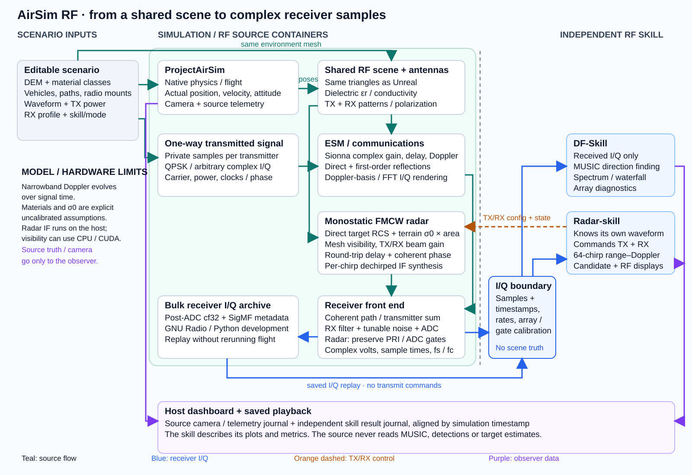

# airsim-rf

Fly a virtual RF system over shared terrain, generate complex receiver I/Q,
and develop signal processing before buying hardware. ProjectAirSim supplies
motion and camera views; the RF source models propagation and receiver behavior;
independent RF skills process the samples.

## Two scenarios

| Scenario | What runs | What you see |
| --- | --- | --- |
| **[Direction finding](scenarios/drone-orbit/README.md)** · `drone-orbit` | A 915 MHz QPSK drone circles two four-element receiving arrays | MUSIC spatial search, receiver spectrum/waterfall, terrain blockage and multipath |
| **[FMCW radar](scenarios/mmwave-radar/README.md)** · `mmwave-radar` | A 77 GHz radar drone flies a racetrack past three stationary ground targets | Range–Doppler map, target candidates and terrain clutter |

Both use the same terrain in the visual and RF scenes, native drone flight,
**20 m minimum planned terrain clearance**, and recorded I/Q/playback. The demo
noise-power offset is **−25 dB** for visibility; **0 dB** restores the original
receiver-noise model. The radar target RCS values are deliberately exaggerated.
These are configurable teaching models, with uncalibrated material and hardware
assumptions. [Edit flight, noise and other scenario settings](docs/demo-tuning.md).

## Run the dashboard

Use **Linux x86-64**, Docker Engine, a compatible NVIDIA driver and NVIDIA
Container Toolkit, plus **Python 3.10+** on the host. No local image build or
host numerical packages are required.

```bash
git clone https://github.com/wa200508/airsim-rf.git
cd airsim-rf

# Direction finding:
bash scripts/run_dashboard.sh --scenario drone-orbit --open
# Or radar:
bash scripts/run_dashboard.sh --scenario mmwave-radar --open
```

Open **http://localhost:8765**. The script pulls and checks the images, starts
three containers together—simulator, RF source and the selected skill—and
processes an initial I/Q window before enabling **Launch mission**.
The web UI runs on the host, outside the private Docker network.

An activated Python virtual environment is honored automatically. Rootless
Docker is supported; use your rootless context and run without `sudo`.
[Rootless GPU setup and troubleshooting](docs/dashboard.md#rootless-docker).

Use **Stop** then **Prepare services** for another mission; **Ctrl+C** cleans up
the launcher's containers and network. Recordings remain in
`recordings/dashboard/replays/<run-id>/`. Review a saved run without starting
Docker or a GPU:

```bash
bash scripts/run_dashboard.sh --replay --run-dir recordings/dashboard --open
```

For standalone launch without cloning, ports, remote display, logs and restart
help, use the **[dashboard guide](docs/dashboard.md)**.

## RF architecture



Only **receiver I/Q and hardware metadata** cross into a skill. The active radar
skill also commands its own TX/RX settings. Camera, scene truth and skill results
meet in the observer; the source does not know which estimation algorithm runs.
The two RF branches have different physics and rendering implementations.
[Architecture and code ownership](docs/architecture.md).

## Explore

| Goal | Guide |
| --- | --- |
| Understand ground returns, multipath, material assumptions and sampling | **[Clutter and terrain response](docs/clutter.md)** |
| Understand update rate, latency, bottlenecks and measured CPU/GPU timing | **[Profiling and timing](docs/profiling.md)** |
| Change antennas, waveform, targets, receivers or flight | [Scenario editing](docs/scenarios.md) · [Find the code](docs/code-map.md) |
| Replay bulk I/Q in GNU Radio or another RF skill | [I/Q capture and replay](docs/iq-replay.md) · [GNU Radio](docs/gnuradio.md) |
| Build, extend or investigate the project | **[Documentation index](docs/README.md)** · [Development](docs/development.md) |

The RF skills live in [DF-Skill](https://github.com/wa200508/DF-Skill) and
[Radar-skill](https://github.com/wa200508/Radar-skill). Current demos have no
whole-flight real-time guarantee; historical P100 fleet benchmarks are different
workloads, detailed on the profiling page. [Licenses and third-party notices](THIRD_PARTY_NOTICES.md).
