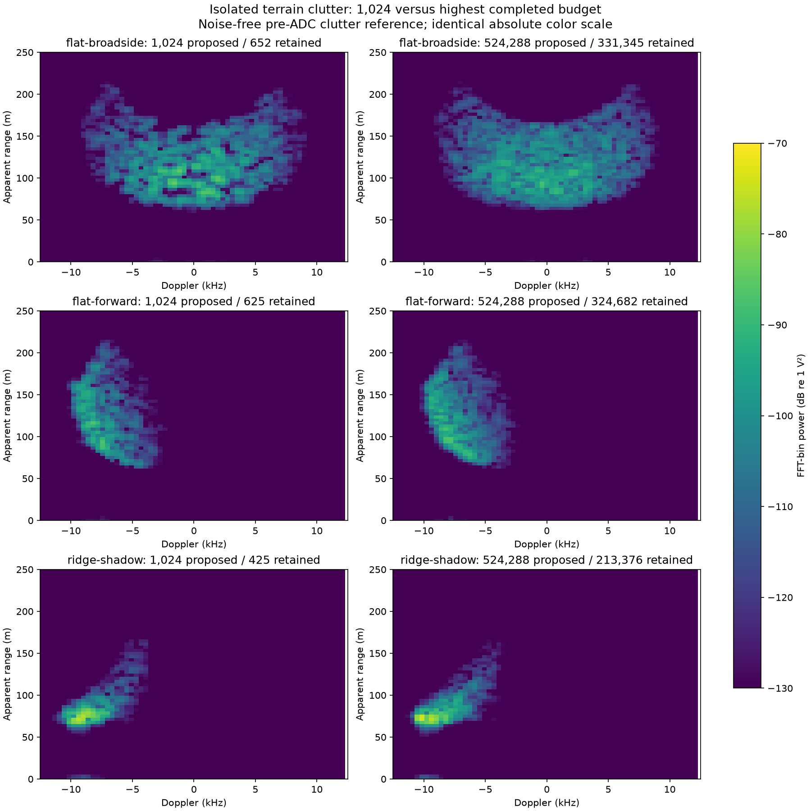

[Documentation](README.md) · [Scenarios](../scenarios/README.md) · [Run dashboard](dashboard.md)

# Clutter and terrain response

The two demos use the same terrain mesh in ProjectAirSim and Sionna, but model
different RF interactions. A hill blocks a direct radio path even when a signal
or a radar candidate remains visible through another modeled return.

| Scenario | What the ground contributes |
| --- | --- |
| [Direction finding](../scenarios/drone-orbit/README.md) | One-way radio multipath: direct and supported first-order specular TX→RX paths. Current demo disables diffuse reflection, diffraction and transmission. |
| [FMCW radar](../scenarios/mmwave-radar/README.md) | First-order backscatter: one TX→terrain patch→RX echo per contributing patch, plus direct point-target echoes. No reflected target-illumination/return legs or secondary scattering. |

Both preserve complex phase and use narrowband Doppler over signal time.
A moving radar gives stationary ground nonzero Doppler. The source renders
complex I/Q; the external skill computes the spectrum or range–Doppler map.

## Why the terrain makes this pattern

The reference below contains **only terrain clutter, before ADC quantization
and with thermal noise omitted**. Left: 1,024 proposed samples; right: 524,288.
Rows: side-looking flat ground, forward-looking flat ground, and a ridge with
actual mesh shadowing. Doppler is horizontal; range increases upward. All six
maps share one absolute IF-voltage power scale.

Side-looking clutter spans both Doppler signs. Looking forward moves it toward
approaching returns. The ridge changes which surfaces contribute: the largest
case blocks 120,408 eligible far-ground patches. These are FFTs of rendered
I/Q, not images painted from ray positions. **[All 30 maps, actual ADC maps,
saved I/Q and reproduction](../results/reviews/clutter-sampling-sweep-20261023/REPORT.md)**.
The experiment uses one random-phase realization per budget; it is not a
statistical convergence proof or calibrated terrain validation.

## Materials and scattering assumptions

For radio-to-radio propagation, dielectric **relative permittivity** and
**conductivity** are explicit scene properties; the model uses nonmagnetic
materials. Visual color does not specify RF properties. The demo earth value
is εr = 5 with conductivity 0.01 S/m, an illustrative constant assumption.

Radar terrain backscatter uses a separate empirical **sigma0**, meaning RCS per
actual surface area. Each patch has effective RCS equal to sigma0 × represented
surface area × cosine of incidence to the configured exponent. The demo uses
sigma0 = −20 dB and exponent 1. This value is not derived from the dielectric
or a material texture. Seeded random complex phases stay fixed on the surface
between chirps, preserving coherent interference and speckle during motion.

Different cover classes can be separate shared mesh objects with material IDs
and backscatter rules. Automatic LULC ingestion and calibrated roughness,
vegetation, polarimetric or multiple-scattering models are not supplied.
Point targets have scalar RCS; their display boxes are not RF meshes.
[Detailed model and source](radar-scattering.md).

## Tune the demo

All settings stay in the selected scenario's neighboring JSON files.

| Quantity | Where to edit |
| --- | --- |
| Minimum planned clearance and climb/descent grade | `flight.json` → actor `flight.terrain_clearance_m`, `max_vertical_grade` |
| General radio-pair sampling budget | `radios.json` → `propagation.samples_per_link` |
| Radar surface classes, sigma0, incidence exponent and phase seed | `radios.json` → `radar.clutter` |
| Radar slant-range cutoff | `radios.json` → `radar.max_range_m` |
| Receiver noise power | DF: `receiver_profile.noise_power_offset_db`; radar: `radar.profile.noise_power_offset_db` |
| Point-target strength | `radios.json` → `radar.targets[].rcs_m2` |

The shared sample field is a **proposal budget**, not a guaranteed number of
surviving paths or a universal cap on specular returns. Exact semantics depend
on the selected solver. Radar defaults to 1,024 points; the DF specular demo
uses a different solver configuration. Visibility, normal, range and TX/RX
patterns determine contributions. Each radar point represents total surface
area divided by the budget, so increasing the budget preserves **expected**
scattered power while changing coverage and speckle. Compute work still grows.

The maintained demos plan at least **20 m clearance** and use a **−25 dB noise
power offset** to expose weak terrain response. **0 dB restores the original
modeled receiver noise**. This is an explicit demonstration setting; ADC effects
remain active. Neither color presets nor more paths can recover a signal lost
below receiver noise or quantization. [Exact tuning semantics](demo-tuning.md).

**[Noisy ADC comparison at four points on the low radar route](../results/reviews/low-terrain-demo-20261024/REPORT.md)**
shows 0, −15 and −25 dB side by side. It is a snapshot audit, not a full native
flight or GPU runtime qualification. [Timing and sample-budget costs](profiling.md).

## Published comparisons

These primary examples provide similar workflows, not calibration of our model:

- MathWorks, [Radar Scenario Clutter Simulation](https://www.mathworks.com/help/radar/ug/introduction-to-radar-scenario-clutter-simulation.html): surface-clutter I/Q, sampling and terrain shadowing.
- MathWorks, [Surface Clutter Power in Range-Doppler Space](https://www.mathworks.com/help/radar/ug/predict-surface-clutter-power-in-range-doppler-space.html): motion and beam squint change clutter support.
- MathWorks, [Site-Specific Bistatic Land Clutter](https://www.mathworks.com/help/radar/ug/bistatic-clutter-part-3-simulating-site-specific-bistatic-land-clutter.html): patch-area/RCS modeling and noise-free versus noisy I/Q comparisons.

The [full source review](references.md#environmental-rf-references) also compares
Ansys, NVIDIA/Sionna, RadarSimPy and other implementations, with inspected-source
scope and qualifications retained.
