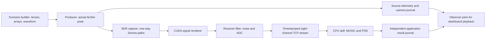

# Where to find the code

For questions about the **current drone-orbit dashboard**, start here. Its
settings are currently split across the scenario builder, producer and receiver
profile. There is no single scenario file that controls all three. This guide
identifies the code that actually runs, the values it selects and the generated
files that show what a particular mission used.

## Read these five places first

| Order | Open this code | What it answers |
| --- | --- | --- |
| 1 | [dashboard_scenario.py — prepare()](../src/airsim_rf/dashboard_scenario.py#L42) and `waveform_window()` | Terrain, receiver laydown, signal samples, simulator configuration and basic constants. |
| 2 | [dashboard_producer.py — run()](../src/airsim_rf/dashboard_producer.py#L14) | Actual flight command, antenna model, transmit power, solver/renderer selection and pose → capture loop. |
| 3 | [sdr.py — SDRNetworkReceiver.capture()](../src/airsim_rf/sdr.py#L267) | Channel coefficients/delays/Dopplers → complex samples → receiver filtering/noise/ADC. |
| 4 | [skills/music.py — MusicSkill.process()](../src/airsim_rf/skills/music.py#L55) | Which received channels/samples MUSIC consumes, calibration, search grid, PSD and diagnostic outputs. |
| 5 | [processing/music.py — estimate_bearing()](../src/airsim_rf/processing/music.py#L27) and `PhysicalULA` | The external MUSIC call, steering model and detection gate. |

The host [dashboard.py](../src/airsim_rf/dashboard.py) mostly launches services,
serves HTTP and selects displayed frames. The JavaScript mostly draws them.
Those are useful for GUI questions; the five locations above answer the RF and
scenario questions.

## Follow one window through the running system



1. [Dashboard.prepare()](../src/airsim_rf/dashboard.py#L143) invokes
   the scenario builder inside the RF image. `prepare()` writes the files listed
   [below](#inspect-what-a-run-actually-used).
2. `dashboard_producer.run()` loads the world, imports the shared terrain, builds
   the Sionna radios and queues the native flight path.
3. Each acquisition reads `get_ground_truth_kinematics()`, converts pose/velocity
   to RF coordinates, updates the Sionna transmitter and creates the next
   `SampledWaveform`. `receiver.capture()` generates the eight ADC channels.
4. [SampleStreamWriter.send_samples()](../src/airsim_rf/sample_stream.py#L116)
   sends neutral post-ADC voltage blocks. [MusicSkill._serve_stream()](../src/airsim_rf/skills/music.py#L103)
   groups them by channel ID and acquisition timestamp; it processes only after
   all eight channels arrive.
5. The producer waits for a generic stream commit, saves only source telemetry
   and then advances the world. See [advance_after_commit()](../src/airsim_rf/dashboard_sync.py#L19).
   [Source journal](../src/airsim_rf/source_recording.py),
   [result journal](../src/airsim_rf/processing/results.py) and
   [observer compositor](../src/airsim_rf/dashboard_recording.py) implement independent
   saving and replay joins. The browser does not run MUSIC and the producer never
   reads MUSIC results. See the [boundary contracts](skill-boundary.md).

## Questions about the scenario, laydown and mover

| Question | Exact source location / search term | Current dashboard selection |
| --- | --- | --- |
| What scenario is this? | [dashboard_scenario.py constants](../src/airsim_rf/dashboard_scenario.py#L7) and `prepare()` | One airborne transmitter, two stationary ground receiving sites, four channels per site. |
| Where are the receivers? | [prepare(): offsets and sites](../src/airsim_rf/dashboard_scenario.py#L71); inspect `center_rf_m`, `element_offsets_m`, `channels` | Site centers at RF north 0 m, west −25/+25 m; each is 8 m above the DEM at that center. Each site's four elements lie along RF west. |
| What moves the drone? | [run(): path construction and move_on_path_async()](../src/airsim_rf/dashboard_producer.py#L122) | Native ProjectAirSim path follower on a nominal 250 m circle, 25 m/s, constant RF-up altitude 200 m; waypoints every 3 degrees. Default mission duration is 120 s. |
| Which vehicle and controller parameters are used? | `prepare()` reads `robot_quadrotor_fastphysics_sensors.jsonc`, edits `MPC_XY_VEL_MAX`, and writes `sim_config/orbit.jsonc` | The pinned upstream Fast Physics quadrotor template supplies the remaining vehicle/controller parameters. The speed limit override is 30 m/s. Read the generated robot file for the full configuration. |
| Is that altitude AGL? | `ALTITUDE`, generated actor `origin`, and `move_by_velocity_z_async()` | It is a local coordinate height. It is **not** 200 m above terrain; clearance changes as terrain elevation changes. |
| Where does actual RF motion come from? | [run(): live pose readback](../src/airsim_rf/dashboard_producer.py#L219) and [bridge.py — mount_kinematics()](../src/airsim_rf/bridge.py#L27) | Actual simulator position, velocity and attitude overwrite the Sionna TX before capture. `orbit_pose()` in the scenario module is an analytic helper used by tests, not the live flight controller. |
| What coordinates are these? | [bridge.py — NED_TO_RF](../src/airsim_rf/bridge.py#L10) | AirSim: north/east/down. RF: north/west/up, metres. Convert signs with `[1, −1, −1]`. |
| What creates the hills? | [terrain.py — demo_terrain()](../src/airsim_rf/terrain.py#L96) and the scaling in `dashboard_scenario.prepare()` | Analytic hills/swale on a 21×21 grid. Dashboard expands it to 800×800 m and RF-up heights 100–190 m; cells are 40 m across and become 800 triangles. It is not a surveyed DEM. |
| Does the visual ground match RF ground? | [geometry.py — export_sionna_geometry()](../src/airsim_rf/geometry.py#L116), [geometry_sync.py — spawn_placements()](../src/airsim_rf/geometry_sync.py#L86), [dashboard_geometry.py — require_rf_mesh_match()](../src/airsim_rf/dashboard_geometry.py#L26) | Same source triangles become Unreal glTF and Sionna PLY/XML. Native Blocks physical scenery is removed by `isolate_blocks_scene()`. |
| What are the ground materials? | `prepare()` → `geometry['materials']` / `objects`; exporter above | Terrain uses `earth`: relative permittivity 5, conductivity 0.01 S/m. `rock` is also declared but no dashboard terrain object uses it. These are illustrative, uncalibrated assumptions. |
| Where are land cover and permeability? | `geometry.py` material schema/export; `dashboard_scenario.prepare()` material assignments | There is no dashboard land-use/land-cover classifier. The schema exports permittivity and conductivity, not a user-selected magnetic permeability map. The scenario uses Sionna's ordinary nonmagnetic radio-material model. |
| Is the camera controlling anything physical? | [dashboard_view.py — camera_frame()](../src/airsim_rf/dashboard_view.py#L6) / `queue_chase_camera_pose()` | It only sets the chase view. Radio beacons from `radio_marker_glb()` are visual markers, not RF antennas or RF scatterers. |

The orbit is commanded to the simulator, so actual motion can differ from the
ideal circle during settling/tracking. For a question about a particular frame,
use its recorded `position_rf_m` and `velocity_rf_m_s`, not an analytic orbit.

## Questions about antennas, waveform and receiver hardware

| Question | Exact source location / search term | Current dashboard selection |
| --- | --- | --- |
| What is the individual antenna pattern? | [run(): scene.tx_array / scene.rx_array](../src/airsim_rf/dashboard_producer.py#L138) | Sionna `PlanarArray(1×1, pattern='iso', polarization='V')` for each TX/RX device. No measured COTS radiation pattern or drone-airframe antenna model is loaded. |
| Where is the four-element array? | `prepare()` offsets, then [run(): receiver placement](../src/airsim_rf/dashboard_producer.py#L140) | Four separate Sionna receiver devices per site, not a single synthetic four-element `PlanarArray`. Element spacing is half a wavelength at 915 MHz, about 0.164 m; aperture is about 0.491 m. |
| What is array orientation/calibration? | `arrays['sites']`; `PhysicalULA.steering_vector()` below | Elements run along +RF west; local broadside is +RF north. Metadata yaw is 0; all complex calibration gains are `[1, 0]`. |
| What waveform does the GUI use? | [waveform_window()](../src/airsim_rf/dashboard_scenario.py#L25) | Deterministic counter-indexed QPSK symbols, 80× upsampling at 2 MS/s: 25 ksymbol/s. An 801-tap Kaiser FIR has a 20 kHz cutoff. This is not the earlier LFM radar waveform. |
| What are the carrier and transmit power? | Scenario `CARRIER`; [run(): SDREmitter construction](../src/airsim_rf/dashboard_producer.py#L144) and the later per-window emitter replacement | 915 MHz; `transmit_power_w=.1` (nominal 100 mW / 20 dBm scaling). The declared baseband bounds are ±100 kHz. The producer overrides the reusable emitter's lower default power. |
| How are waveform amplitude and delay handled? | [sampled_waveform.py — SampledWaveform](../src/airsim_rf/sampled_waveform.py#L11); `SDRNetworkReceiver.capture()` | Private timestamped sampled buffers with history/lookahead and 32-tap interpolation by default. Amplitudes are preserved; there is no automatic unit-power normalization. Actual waveform RMS therefore matters when interpreting the nominal TX power setting. |
| Which receiver is modeled? | [sdr.py — PlutoSDRProfile](../src/airsim_rf/sdr.py#L19); producer selects `PlutoSDRProfile(noise_enabled=True)` | Pluto-class approximation: 2 MS/s, 1 MHz RF bandwidth, 10 dB NF, 290 K, 50 Ω, input-referred full scale −30 dBm and 12-bit I/Q ADC. Several values are modeling estimates, not board measurements. |
| Where are filtering, noise and clipping? | [SDRNetworkReceiver.__init__(): filter](../src/airsim_rf/sdr.py#L254); `capture()` → `rf.receiver.noise_filter_adc`; [quantize_iq()](../src/airsim_rf/sdr.py#L100) | Fourth-order Butterworth low-pass, thermal/noise-figure noise and independent signed I/Q quantization/clipping. `continuous=True` preserves receiver filter state across windows. Output complex volts are reconstructed from ADC codes. |
| Are radios phase/clock synchronized? | [sdr.py — RadioClock](../src/airsim_rf/sdr.py#L54) and basis-renderer checks in `SDRNetworkReceiver.__init__()` | Ideal default zero clock error and zero phase offset. The selected basis renderer requires equal nominal clocks. This is not a hardware synchronization simulation. |

The 20 kHz TX shaping cutoff, ±100 kHz declared waveform bounds, 1 MHz receiver
bandwidth and ±100 kHz displayed PSD range are different settings. Changing the
plot range does not change the transmitter or receiver filter.

## Questions about propagation and I/Q generation

| Question | Exact source location / search term | What the dashboard exercises |
| --- | --- | --- |
| Which propagation solver is selected? | Producer's `SDRNetworkReceiver(...)` arguments | `path_solver='single-bounce'`, `max_depth=1`, not the reusable API's default scattering mode. |
| Where is path discovery? | [single_bounce.py — SingleBouncePathSolver](../src/airsim_rf/single_bounce.py#L148) and `_PlanarCandidates` | Enumerated direct/first-order planar specular candidates, visibility validation and Sionna's image/material/polarization machinery. No randomly launched discovery rays in this adapter. |
| Why does the call say only two samples? | Producer `samples_per_link=2`; solver class docstring | This compatibility argument is not a cap of two physical paths or two launched rays in the selected exhaustive adapter. It is not the 1028-sample diffuse-scattering benchmark. |
| What effects are omitted here? | `SingleBouncePathSolver`, `_PlanarCandidates.__call__()`; `SDRNetworkReceiver.diffuse` | No dashboard diffuse scattering, diffraction, refraction or higher-order reflections. [scattering.py](../src/airsim_rf/scattering.py#L269) is a different optional solver. |
| Where are paths turned into I/Q? | `SDRNetworkReceiver.capture()` → `self.basis_renderer.render()` → [research/doppler_basis_cuda.py — CudaDopplerBasisRenderer.render()](../src/airsim_rf/research/doppler_basis_cuda.py#L338) | The dashboard selects `renderer='basis-cuda'`: path-to-filter projection and FFT filtering with a Doppler basis. The `research/` directory name does not mean this implementation is unused. |
| Where is the readable CPU counterpart? | [research/doppler_basis.py — DopplerBasisRenderer.render()](../src/airsim_rf/research/doppler_basis.py#L120); [receiver.py — synthesize_voltage()](../src/airsim_rf/receiver.py#L54) | The first explains the basis algorithm; the second is a direct reference operator. Neither is the selected CUDA renderer in the live dashboard. |
| How is Doppler handled? | Pose velocity in the producer; `paths.doppler` in `capture()`; basis renderer | Narrowband per-path frequency/phase evolution over fast time. Geometry, path delays and gains are frozen per capture window. No wideband Doppler time dilation; no ray tracing per ADC sample. |
| What is the update timescale? | Scenario `ADVANCE_NS`; generated clock config; `Skill.process()` | 3 ms physics steps; **120 ms RF windows** (about 8.33 channel updates per simulated second), 240,000 complex samples per channel. MUSIC uses the first 24,000 samples, or 12 ms, from each window. This GUI is not the 120 Hz performance benchmark. |
| Who removes a direct path behind a hill? | Solver visibility; [dashboard_geometry.py — link_geometry()](../src/airsim_rf/dashboard_geometry.py#L42) | The solver determines RF paths. `link_geometry()` independently checks/labels actual per-element direct-path counts and terrain intersections; it does not mute the signal or invent echoes for the display. |

## Find the actual MUSIC algorithm

The live consumer has three layers:

1. **Acquire and prepare inputs:** `skills.music.MusicSkill.process()` constructs
   a four-channel matrix per site from the **first 24,000 received ADC samples**
   of every channel, divides by configured complex gains, and checks coherent
   epochs/rates. It searches −70° to +70° on a 1401-point grid (0.1° increments).
2. **Choose a bearing:** [processing.music.estimate_bearing()](../src/airsim_rf/processing/music.py#L27)
   validates geometry, computes covariance/eigenvalues, requires a largest /
   second-largest eigenvalue ratio of at least 5, then calls
   **`doa_py.algorithm.music(..., num_signal=1, ...)`** and chooses its peak.
   Grid-edge peaks are marked undetected.
3. **Plot the search curve:** [processing.music.spatial_spectrum()](../src/airsim_rf/processing/music.py#L86)
   calls the same external MUSIC routine and normalizes its curve to a 0 dB
   maximum. It does not apply the detection gate. A visible peak in a normalized
   noise-only curve is therefore not automatically a detected emitter.

The steering-vector implementation we supply to that dependency is
[PhysicalULA.steering_vector()](../src/airsim_rf/processing/music.py#L22).
It uses metre offsets and the RF carrier. The MUSIC eigenspace/pseudospectrum
implementation itself is in the **external open-source
[doa_py package](https://github.com/zhiim/doa_py)**, not vendored into this repo.
Version 0.5.0 is pinned in [requirements-tracking-lock.txt](../requirements-tracking-lock.txt)
and the tracking extra in [pyproject.toml](../pyproject.toml).

To open the exact implementation installed in your running skill container,
list container names, replace `YOUR_SKILL_CONTAINER`, and run:

```bash
docker ps --format '{{.Names}}'
docker exec YOUR_SKILL_CONTAINER python -c 'import inspect; from doa_py.algorithm import music; print(inspect.getfile(music)); print(inspect.getsource(music))'
```

The host dashboard virtual environment deliberately does not need this package;
inspect it in the skill container or a scientific environment with the tracking
extra installed.

`skills.music.start_control()` provides the SQUALL-style gRPC control/status
interface. The generated files in `src/airsim_rf/ams/` describe that protocol;
they do not implement the MUSIC algorithm.

**Interpretation:** the dashboard estimates one dominant arrival candidate per
site, not a unique full-circle 3D bearing or a fused emitter position. A ULA has
front/back/elevation ambiguities, and coherent multipath can compromise plain
single-source MUSIC. The skill receives ADC samples and array metadata, not TX
truth or ray paths. Ground-track and obstruction labels separately use simulator
truth. Offline `aoa_tracking.consume()` adds bearing intersection and FilterPy
tracking under its own assumptions; the dashboard does not call that function.

## Code supplied by upstream projects

| Component | Where to inspect it |
| --- | --- |
| MUSIC numerical routine | Installed `doa_py.algorithm.music`, using the inspection command above. [Third-party notices](../THIRD_PARTY_NOTICES.md) record its source and license. |
| Sionna paths, materials and antenna element patterns | The installed `sionna.rt` package, including `PathSolver`, `RadioMaterial` and `PlanarArray`. The local `SingleBouncePathSolver` adapter changes candidate discovery and visibility; it delegates the remaining path machinery. The [pinned source tree](https://github.com/NVlabs/sionna-rt/tree/15b5ee036917a4c2a9b6420e05570b77717e2fcc) and version are recorded in [sources.json](../sources.json). |
| AirSim Python RPC client and robot template | [Pinned ProjectAirSim source tree](https://github.com/iamaisim/ProjectAirSim/tree/cfb865f29f255b15ef28ec8fdcfaa01a6b66497f), especially `client/python/projectairsim` and `client/python/example_user_scripts/sim_config/robot_quadrotor_fastphysics_sensors.jsonc`. [scripts/bootstrap.py](../scripts/bootstrap.py) installs a sparse client/examples checkout under `.deps/ProjectAirSim` inside the image. |
| Native flight physics, controller and Unreal rendering | ProjectAirSim server code/binary, outside this Python integration package. The actual packaged Blocks server asset URL and checksum are in [scripts/prepare_unreal_blocks.py](../scripts/prepare_unreal_blocks.py); [Dockerfile.dashboard](../Dockerfile.dashboard) installs it. Its release asset pin is separate from the Python SDK source pin. |

The host launcher intentionally has no scientific dependencies, and `.deps/` is
gitignored. A normal checkout search therefore cannot find the installed MUSIC
routine or the native simulator implementation. Use the appropriate container
or pinned upstream source when a question crosses that boundary.

## Inspect what a run actually used

Source defaults explain a fresh run. Generated files and saved frames answer
questions about a specific run. With the default `--run-dir`:

```text
recordings/dashboard/
  arrays.json                    source-side array metadata
  receiver-config.json           receiver-only site geometry, channels, rates and calibration
  scenario.json                  terrain grid and scenario summary
  sim_config/scene.jsonc         actor spawn and steppable physics clock
  sim_config/orbit.jsonc         generated robot, sensor and controller configuration
  bundle/geometry.json           shared triangles, materials and transforms
  bundle/scene.xml                Sionna material/mesh bindings
  bundle/Terrain.ply              actual RF terrain mesh
  scene-alignment.json           simulator/Sionna geometry validation results
  producer.json                  latest actual pose, paths and timing (overwritten)
  replays/<run-id>/
    manifest.json                creation time, status and computed extent
    scenario.json                this archived run's terrain/site description
    frames/<sim-time-ns>.json     source telemetry/truth only
    results/<timestamp-ns>.json   independent receiver-application measurements
    camera/<frame-key>.jpg        actual camera image
    camera/<frame-key>.json       camera timestamp and geometry hash
```

For example, `python3 -m json.tool recordings/dashboard/arrays.json` prints the
current receiver laydown without requiring NumPy. For a past mission, use its
archive: top-level generated files are replaced by subsequent preparations.
Archive `frames/*.json` contains `producer` truth/geometry/timing; separate
`results/*.json` contains application measurements (`bearings`, `psd`, `music_db`, eigenvalues, relative phases,
`payload_bytes`, `complete_windows`, `processing_latency_ms`). The replay archive
contains diagnostics and camera images, **not full raw ADC I/Q**.

The generated files are outputs, not a durable scenario editor. A new Prepare
services operation regenerates them. They also do not expose every runtime
choice: antenna pattern, power and receiver/solver selection still come from
the producer/profile code above.

## Editing a scenario without missing a second definition

| Intended change | Review these together |
| --- | --- |
| Carrier or sample rate | `dashboard_scenario.CARRIER` / `FS`; producer `PlutoSDRProfile(...)` (currently inherits fixed defaults); `PlutoSDRProfile` values; receiver-config rate/carrier values used by skill status; array spacing, waveform upsampling and plot labels. Editing only a global is insufficient. |
| Orbit radius / initial location | `RADIUS` and native path construction; the literal `250 0 ...` actor spawn in scenario `prepare()`; initial Sionna TX `[250, 0, ALTITUDE]` in the producer. Live readback replaces the latter before acquisition. |
| TX power | Every producer `SDREmitter(...)` call: initial construction, preparation and per-window replacement. Editing only `SDREmitter`'s default has no effect on these explicit overrides. |
| Receiver positions / number of channels / array yaw | `prepare()` site metadata plus the producer's physical `[0, offset, 0]` placement and the MUSIC steering/calibration assumptions. Changing stored `yaw_rad` alone does not rotate live physical elements or turn dashboard cone angles into global bearings. `read_arrays()` currently requires two sites. |
| RF-window length | `ADVANCE_NS`, `count`, camera `capture-interval=.12`, skill's 24,000-sample snapshot and reported block size, 60 ms camera matching bound and UI captions. Physics step size is a separate setting. |
| Terrain/materials | Scenario `prepare()` and `demo_terrain()`; regenerate the shared bundle and placement together. Mesh color/emission in the producer only changes appearance. |
| MUSIC source count or detection rule | `estimate_bearing()` and `spatial_spectrum()` both call MUSIC with `num_signal=1`. Review both, the eigenvalue-ratio gate and ambiguous-arrival UI interpretation. |
| Receive impedance / gain / full scale | `PlutoSDRProfile`, `quantize_iq()`, calibration metadata and the skill's received-power calculation (currently literal 50 Ω). |

## Similar-looking code that belongs to other workflows

| Files / directories | Role |
| --- | --- |
| [aoa_example.py](../src/airsim_rf/aoa_example.py), [examples/aoa_emitter_tracking.py](../examples/aoa_emitter_tracking.py) | Offline scripted-trajectory QPSK/MUSIC/FilterPy example. It has different layout, power, window length and waveform normalization from the dashboard. |
| [radar.py](../src/airsim_rf/radar.py), [fmcw.py](../src/airsim_rf/fmcw.py), [examples/distance2gol_radar.py](../examples/distance2gol_radar.py) | Pulsed LFM point-target radar and COTS-style FMCW examples; these do not define the dashboard's QPSK SDR scenario. |
| [scenario.py](../src/airsim_rf/scenario.py), [live.py](../src/airsim_rf/live.py), [sdr_bridge.py](../src/airsim_rf/sdr_bridge.py) | General scenario/live capture interfaces, separate from the dedicated dashboard producer. |
| [benchmarks/](../benchmarks), [scripts/run_gpu_profile.py](../scripts/run_gpu_profile.py), [src/airsim_rf/research/](../src/airsim_rf/research) | Workloads and renderer development. Benchmark scenarios are not automatic dashboard defaults. The selected CUDA basis renderer nevertheless lives in `research/`. |
| [tests/test_dashboard.py](../tests/test_dashboard.py), [tests/test_dashboard_scene.py](../tests/test_dashboard_scene.py) | Dashboard source continuity, real skill ingress, shared terrain and occlusion checks. Several tests use stubs/fixtures; inspect each test's scope before treating it as a full live mission. |
| [tests/test_aoa_tracking.py](../tests/test_aoa_tracking.py), [tests/test_sdr.py](../tests/test_sdr.py), [tests/test_single_bounce.py](../tests/test_single_bounce.py) | Focused MUSIC, receiver and solver behavior. |
| [results/](../results), [research_results/](../research_results), [docs/figures/](figures) | Recorded evidence and generated figures. These files do not configure new runs. |

For operating instructions use the [dashboard guide](dashboard.md). For broader
RF model contracts use [interfaces](interfaces.md), [rendering](rendering.md)
and [terrain assumptions](terrain.md).

To jump to the main edit points from a terminal or an editor's search panel:

```bash
rg -n 'def prepare|def waveform_window|FS=|CARRIER=|RADIUS=|ALTITUDE=|SPEED=' src/airsim_rf/dashboard_scenario.py
rg -n 'PlanarArray|transmit_power_w|move_on_path_async|get_ground_truth_kinematics|SDRNetworkReceiver' src/airsim_rf/dashboard_producer.py
rg -n 'def process|24000|linspace' src/airsim_rf/skills/music.py
rg -n 'def estimate_bearing|def steering_vector|num_signal=1|contrast<5' src/airsim_rf/processing/music.py
```

Source links jump to the current line; the named functions/classes and these
search terms are the durable way to relocate them after later edits.
