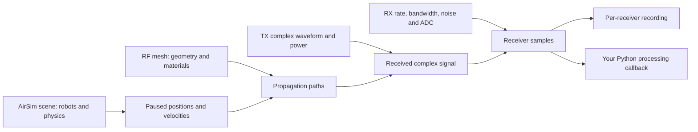

# Build a scenario and use its I/Q

For the current complete installed-package path with matching shared geometry,
start with the [shared-scene quickstart](quickstart.md). This page retains the
ground-only workflow and expands the waveform/processing interfaces.

Start with one transmitter, one receiver and flat ground. First record a known
150 kHz tone; then replace the waveform, scene or processing function one at a
time. You can analyze a saved recording on a CPU without running AirSim or a GPU.
The generator and commands below are intended to run from the repository root,
in the [installed Python environment](setup.md).

## What makes up a scenario?



The simulator world and RF mesh are **two representations of the same physical
space**. Buildings shown in AirSim do not automatically become RF obstructions.
Keep geometry, origin, meters and scale aligned. Simulator poses use NED
(north/east/down); RF coordinates use north/west/up: `(x, -y, -z)`.
`mount_body_m` places a radio relative to its robot's body; rotation and angular
velocity affect offset mounts. The simple starter has zero offsets. A
[turning-flight qualification](../results/reviews/turning-mounts-20261015/REPORT.md)
checks nonzero mounts on two yawing drones against independently reconstructed
positions, velocities and recorded direct-path I/Q.

A radio ID such as `tx0` or `rx0` is your experiment's label. Its `robot` field
names a robot in the simulator scene. Multiple radios may share a robot; one
receiver observes the sum of all transmitters through their respective paths.

## 1. Generate complete inputs

```bash
python examples/prepare_live_example.py --output recordings/my-scenario
python -m airsim_rf.live --config recordings/my-scenario/radios.json --check-config
```

The output directory must be new. It contains:

| File | What you change |
|---|---|
| `radios.json` | Robot-to-radio mapping, waveform path, transmit power, receiver settings and propagation choice |
| `sim_config/scene_rf.jsonc` | Robot names, initial poses, simulation clock and robot configuration references |
| `sim_config/robot_rf.jsonc` | Starter non-physics robots; replace with a suitable physics/controller configuration for flight |
| `rf_ground.xml`, `ground.ply` | RF ground geometry and synthetic material |
| `tx0.npy` | Finite one-dimensional complex waveform at the configured sample rate |

The starter places radios at RF (−20, 0, 20) and (20, 0, 20) m over z=0 ground.
They are **stationary non-physics robots**: this is an integration example, not
a demonstration of drone flight. Its source has 500,000 unit-power samples at
2 MS/s: 0.25 s of a +150 kHz baseband tone. The carrier is 915 MHz. The starter
uses one vertically polarized half-wave dipole per radio.

The generator now explicitly selects `specular`, a direct-plus-ground-reflection
starter. Existing configurations without a propagation section retain the older
`diffuse-angular` behavior. Choose a mode explicitly for reproducibility:

```json
"propagation": {
  "mode": "specular",
  "samples_per_link": 1028,
  "seed": 42
}
```

| Mode | Included paths | Main limitation |
|---|---|---|
| `direct` | LoS only, with obstruction checks | No reflection or diffuse energy |
| `specular` | LoS and first-order specular reflection | No higher-order reflections or diffuse paths |
| `diffuse-angular` | LoS, specular and importance-sampled diffuse paths | Moving samples are not persistent surface scatterers |
| `diffuse-surface` | LoS, specular and experimental fixed-surface diffuse samples | Needs sufficient mesh-area sampling; not calibrated roughness |

`--propagation diffuse-surface` on the generator creates this experimental choice
with 4,096 samples/link. That is a starting budget, **not a convergence guarantee**;
[power sensitivity](../results/reviews/diffuse-surface-20261012/REPORT.md) can be
substantial. `samples_per_link` counts attempted diffuse samples, not guaranteed
valid paths. It does not control the number of recorded I/Q samples.

Set antennas independently for all TXs and all RXs:

```json
"antennas": {
  "tx": {"pattern": "tr38901", "polarization": "V"},
  "rx": {"pattern": "iso", "polarization": "V"}
}
```

Patterns are `iso`, `dipole`, `hw_dipole` and `tr38901`; polarization is `V` or
`H`. Omitted settings preserve `hw_dipole`/`V`. Each radio has one element and
one polarization channel; per-radio mixed arrays and dual-polarized outputs are
not exposed by this configuration. `tr38901` boresight is local +x, following
robot attitude after coordinate conversion. `mount_body_m` offsets position; it
does not specify an independent antenna pointing rotation.

`--check-config` validates the receiver profile, propagation choices, local files,
radio IDs, mount coordinates and finite waveforms without contacting a server.
It cannot establish simulator/RF geometry alignment or calibrated RF realism.

## 2. Start the simulator and record

Use the [Runtime container setup and GPU recording command](live-workflow.md#complete-two-radio-first-run).
With the server running, execute in the CUDA environment:

```bash
python -m airsim_rf.live --config recordings/my-scenario/radios.json \
  --output recordings/my-first-run --updates 10 --advance-ns 10000000
```

On the available P100 stack, use `python scripts/basis_launch.py -m airsim_rf.live`
and add `--pascal-compat`, as shown in the linked container recipe. That flag is
an environment compatibility choice, not a property of the RF scenario.

The command loads the simulator scene, pauses it, and advances it under recorder
control. Do not concurrently reload or step that world from another client.
It leaves the simulator paused. Output must be a new directory.

Ten requested 10 ms steps can become ten **12 ms** windows with the starter's
3 ms physics tick: **0.120 simulated signal seconds**, or **240,000 complex
samples per receiver at 2 MS/s**. The actual manifest, not the requested cadence,
is authoritative. Wall execution time is separate and can be much longer.

## 3. Read samples into your own processor

```bash
python examples/process_recording.py recordings/my-first-run --receiver rx0
```

Edit the example's `process(samples, sample_rate_hz)` function, or use the reader
directly in a notebook:

```python
from airsim_rf.recording import iter_iq_blocks

for block in iter_iq_blocks("recordings/my-first-run", "rx0"):
    iq = block.samples              # complex64, I + jQ, reconstructed ADC volts
    fs = block.sample_rate_hz       # samples/second
    start = block.sample_start     # complex sample offset, not a byte offset
    epoch_ns = block.sim_time_ns    # integer simulator timestamp
    # Feed iq and fs to your demodulator, matched filter, FFT, correlator, etc.
```

The reader yields one channel-update window at a time; keep your own filter,
oscillator and overlap state between blocks. It checks completion, offsets,
timestamps, file size and code range. It rejects failed/in-progress captures;
it is not a file-tail streaming service. Use `units="adc_codes"` to get complex
raw code values instead of reconstructed volts. Keep receiver IDs separate when
processing multiple sites. Concurrent receivers share simulation time; their
durations are not summed to obtain elapsed simulation time.

For sample-relative time, use `n / fs`. Across blocks use
`(epoch_ns - first_epoch_ns) * 1e-9 + n / fs`, subtracting integer timestamps
**before** converting to seconds. Avoid converting a large absolute nanosecond
epoch to floating point and then adding individual sample intervals.

### Use the official SigMF reader without the simulator package

A separate analysis environment only needs NumPy and `sigmf==1.13.0`:

```bash
python -m pip install numpy sigmf==1.13.0
python examples/process_sigmf.py recordings/my-first-run/rx0.sigmf-meta
```

The example disables automatic integer normalization (`autoscale=False`), reads
capture segments, and applies their volts-per-count values. This path is checked
against the project reader using actual recordings. [Interoperability evidence](../results/reviews/sigmf-interop-20261015/REPORT.md).
The [local extension specification](extensions/airsim_rf.sigmf-ext.md) defines
simulator timestamps, voltage scaling and clipping fields. Core SigMF validation
checks structure; it does not certify physical calibration or completeness of an
in-progress capture. Use immutable completed recordings.

## 4. Process during capture

```bash
python examples/process_live.py --config recordings/my-scenario/radios.json \
  --output recordings/my-processed-run
```

Use the same P100 launcher/compatibility option when appropriate. The example
uses this public interface:

```python
from airsim_rf.live import run

def process(receiver_id, capture):
    iq = capture.adc_iq_volts       # post-ADC, same values represented by recording
    fs = capture.actual_sample_rate_hz
    # Your stateful algorithm here; keep state per receiver_id.

run("recordings/my-scenario/radios.json", "recordings/my-processed-run",
    updates=10, advance_ns=10_000_000, on_capture=process)
```

The callback runs synchronously after all receiver data for that window is saved.
The simulator is paused while you process. It is called once per receiver, in
configuration order. A slow callback slows wall execution; its time is included
in recorded service time. An exception stops capture and marks the manifest
failed, retaining already written data. Copy arrays if retaining them for later
use. This is an **in-process sample stream**, not UDP, a physical SDR driver, or
a promise of real-time delivery. To process in a separate process, use the
[experimental TCP adapter](iq-stream.md), which retains recordings and checks
explicit consumer completion.

`capture.input_iq_volts` is the pre-ADC filtered signal; `adc_iq_volts` is the
quantized/reconstructed signal; `adc_codes` is an `(N, 2)` signed int16 I,Q array.
Use the stage appropriate to your experiment and report which one you used.
A weak signal can have large relative quantization error without clipping: the
[directional-flight check](../results/reviews/directional-turns-20261015/REPORT.md)
measured about 5% I/Q error at eight RMS ADC counts. Inspect signal level in
counts as well as clipping; do not equate no clipping with adequate resolution.

If your application already owns the simulator, RF receiver and flight control,
use `airsim_rf.live.record(world, robots, receiver, ..., on_capture=process)`
instead of `run`, which reloads a scene. The receiver must be continuous and all
radios must be mapped. The [two-drone qualification](../results/reviews/moving-receiver-20261011/REPORT.md)
provides a real Fast Physics/controller example; its harness also records actual
kinematics and path exports for validation. Flight-control orchestration and RF
capture must share a single owner of simulation stepping.

## File interoperability and units

Each receiver has `rx0.sigmf-data` and `rx0.sigmf-meta`; `manifest.json` records
completion and window counts. Data is headerless little-endian signed int16,
interleaved `I0,Q0,I1,Q1,...`, containing signed 12-bit codes (−2048…2047).
One complex sample occupies **four bytes**. It is not float32 complex data.
Standard SigMF fields identify datatype, sample rate, carrier and capture offsets;
`airsim_rf:*` fields carry simulator time, clipping and volts-per-count.
Our Python reader handles this project's layout, not every possible SigMF dataset.

For MATLAB, GNU Radio, or another tool, read signed little-endian int16, pair
adjacent values into I+jQ, and apply each capture's `airsim_rf:volts_per_count`.
Use `core:sample_start` to locate calibration changes. Preserve the sample rate,
carrier and timestamps alongside exported samples. Dividing by 32768 or assuming
an ADC full-scale voltage will not reproduce this receiver model's scale.
These are input-referred complex volts, not watts or dBm; the configured impedance
and the model's power convention are needed for power conversion.

## Change one part of the experiment

- **Waveform:** replace `.npy` with finite complex samples at the configured rate.
  Declare occupied baseband frequency bounds, inside Nyquist. Samples are not
  normalized or repeated; TX watts scale their squared amplitude. The file starts
  at the initial capture epoch, and samples outside it are zero. Supply enough
  duration and interpolation margin for actual elapsed physics time.
- **Geometry:** edit both simulator geometry and RF mesh consistently. The
  standalone Runtime only supplies flat-ground collision; it does not validate
  an Unreal building/terrain export. The [shared USD/GLB workflow](openusd-workflow.md) now qualifies nonprimitive
  matching geometry and moving radios. Arbitrary existing-world extraction is
  still a separate source adapter. Synthetic RF material values are assumptions.
- **Motion:** replace the starter non-physics robot with a suitable controller
  configuration and own the flight commands/stepping. Changing RF-only positions
  does not prove a live flight-control workflow.
- **Receiver:** edit rate, RF bandwidth, noise and ADC model in `receiver_profile`.
  Validate again; the bandwidth must be below the sample rate. Current live radio
  clocks are nominal and all receiver streams share the configured rate.

The [workflow evidence](../results/reviews/iq-workflow-20261014/REPORT.md) checks
all four modes through a real Runtime server, GPU capture, callback, file and CPU
reader. It does not establish Unreal alignment, distributed SDR transport,
calibrated hardware behavior or coherent diffuse I/Q under general moving scenes.
A separate [moving-I/Q qualification](../results/reviews/moving-iq-20261014/REPORT.md)
checks two controlled drones with fixed-surface scattering and a direct path
that disappears behind an RF screen. These executable harnesses show how flight
control and capture share ownership of simulation stepping.
