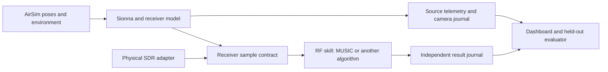

# Simulation, receiver and RF skill boundaries

> The deployed receiver application is now the separately maintained
> [Direction Finding RF Skill](https://github.com/wa200508/DF-Skill), using MUSIC.
> See [repository separation and pinned deployment](direction-finding-skill.md).

The repository had boundary violations: the dashboard RF producer polled
MUSIC-specific HTTP endpoints and fetched processing diagnostics to record each
frame; the consumer imported offline recording/evaluation helpers. Those paths
have been separated. A receiver application now sees the same acquisition
contract regardless of where the samples originate. The simulator does not
import, select or inspect the receiver algorithm.

## The intended structure

The physical-SDR arrow is an adapter requirement, not an implemented or tested
hardware driver. Neither an antenna model nor a skill can infer the physical
origin of samples from this interface. The skill legitimately knows its own
array geometry, calibration, acquisition clocks, tuning and sample rate. It
does not receive the emitter's location, waveform, channel coefficients, ray
paths, visibility labels, terrain or simulator configuration.

| Plane | Owns | Must not depend on |
| --- | --- | --- |
| Simulation/source | Environment, platform dynamics, emitted samples, propagation, receiver impairments and post-ADC samples | MUSIC, tracking, detection results or application HTTP schemas |
| Receiver contract/adapter | Channel IDs, acquisition timestamps, sample offsets, rates, carrier and calibrated complex volts | Source truth or an algorithm's meaning of its results |
| RF skill | Signal analysis, estimation, receiver calibration, algorithm state and application outputs | A simulator, scene or private emitter/path truth |
| Observer/orchestrator | Service lifecycle, source configuration, synchronized presentation, record joins and held-out scoring | Feeding truth or evaluation answers into a deployed skill |

Knowing its own receiver location is valid; knowing an unknown emitter's
position is not. Simulation truth stays in its own plane even when both planes
use the same host directory or network.

An active radar may legitimately use its own commanded transmit waveform; comms
may use known pilots, and a passive system may have a measured reference channel.
Those must come through the corresponding physical-style reference/control
contract. The MUSIC skill uses none of them and cannot read a simulator's private
transmit buffers. Active Radar-skill commands its own waveform and receive
settings through a hardware-neutral adapter, without importing its simulation source.

## Actual code and contracts

| Responsibility | Implementation |
| --- | --- |
| Neutral in-process and TCP I/Q | [sample_stream.py](../src/airsim_rf/sample_stream.py): `SampleBlock`, `SampleStreamWriter`, `iter_stream` |
| Live acquisition adapter | [live.py](../src/airsim_rf/live.py): `on_samples(block)` after ADC conversion |
| Source-format compatibility | [iq_stream.py](../src/airsim_rf/iq_stream.py) and [recording.py](../src/airsim_rf/recording.py): v1 TCP/SigMF → neutral samples |
| Direction Finding RF Skill | [DF-Skill app.py](https://github.com/wa200508/DF-Skill/blob/main/src/df_skill/app.py): `DirectionFindingSkill`; local `skills/music.py` is a legacy re-export |
| Receiver-only algorithms | [DF-Skill MUSIC math](https://github.com/wa200508/DF-Skill/blob/main/src/df_skill/music.py) (local `processing/music.py` is a re-export), [tracking.py](../src/airsim_rf/processing/tracking.py), [radar.py](../src/airsim_rf/processing/radar.py), [sensing.py](../src/airsim_rf/processing/sensing.py) |
| Simulator RF loop | [dashboard_producer.py](../src/airsim_rf/dashboard_producer.py) |
| Generic lockstep/backpressure | [dashboard_sync.py](../src/airsim_rf/dashboard_sync.py) |
| Separate journals | [source_recording.py](../src/airsim_rf/source_recording.py), [processing/results.py](../src/airsim_rf/processing/results.py) |
| Observer joins and presentation | [dashboard_recording.py](../src/airsim_rf/dashboard_recording.py), [dashboard.py](../src/airsim_rf/dashboard.py) |
| Explicit truth-based assessment | [evaluation/tracking.py](../src/airsim_rf/evaluation/tracking.py), [evaluation/clocks.py](../src/airsim_rf/evaluation/clocks.py) |

`SampleBlock` contains only `receiver`, `samples` (complex64 calibrated volts),
`sample_start`, `timestamp_ns`, `sample_rate_hz`, `carrier_hz` and clipping
fraction. An acquisition timestamp can come from a physical clock or a logical
simulation clock; the algorithm does not branch on its origin. Coherent-array
channels must agree on clock, offset, sample count, rate and carrier. The adapter
must supply calibrated values and those guarantees; changing a file label cannot
make unsynchronized hardware coherent.

The dashboard sends TCP **v2** metadata with `timestamp_ns`; legacy v1's
`sim_time_ns` is translated only at ingress. V2 rejects extra metadata fields,
including truth. The old `IQStreamWriter` remains a v1 source adapter. See the
[wire contract](iq-stream.md) for framing and validation.

At the end of a window the source requests a generic `window_end` commit. The
consumer returns `window_ack` only after its handlers return and complete-channel
validation succeeds. It may compute MUSIC, energy, another algorithm or simply
drain the stream. The simulator checks only sequence, acquisition timestamp and
sample totals. A timeout, processing failure or stop prevents an unacknowledged
advance; no MUSIC result, detection success or HTTP response is inspected.
This controlled-stepping policy affects execution pace, not generated RF physics.

## Deployment and recording isolation

`Dockerfile.dashboard` builds the skill from an independent slim Python base,
with an explicit source allowlist. It contains the sample contract, receiver
processing/application modules and generated control protocol; it has no AirSim,
Sionna, Mitsuba, Dr.Jit, CuPy, Unreal server or simulation/source Python modules.
The simulator and RF services retain their own required runtime.

The skill receives a read-only `/config/arrays.json` mount containing only the
generated `receiver-config.json`: rate, carrier, sites, channel IDs, geometry and
calibration. Its only writable archive mount is `/results`. It cannot access the
source's `/run`, geometry bundle, scenario or telemetry via a bind mount. It does
not need a Docker socket. This is dependency/data-contract separation, not an
adversarial network security or container-escape claim.

Schema-v2 archives keep `frames/<timestamp>.json` producer-only and
`results/<timestamp>.json` application-only. The source never reads results.
The observer joins them by acquisition time, then pairs an actual camera image
with matching geometry within the existing 60 ms bound. Computed source progress
and playable joined progress are separate. Old combined schema-v1 archives
remain readable. The source snapshot at mission T+0 is still reused without
duplicate transmission. Recording remains independent of browser polling.

## AMS-GRA mapping and limits

The simulated RF device corresponds to acquisition/the simulation plane; MUSIC
is an RF skill consuming acquisition data. [The dashboard manifest](../deploy/dashboard/skill-manifest.json)
declares its separately deployed service and SQUALL-derived control schema.
Control/status responses use receiver configuration, not hard-coded scenario
frequencies. MUSIC cannot tune the acquisition device and explicitly rejects
those commands rather than pretending to control it.

The coherent multi-channel TCP stream is a **project extension**. It is not native
RF MEL/VITA conformance. Stock bare SC16 UDP lacks the channel timing/calibration
contract this MUSIC example requires. The existing
[AMS device adapter](../src/airsim_rf/ams/backend.py) exposes SC16 receiver data and
its control service; [distributed worker coordination](../src/airsim_rf/distributed)
may legitimately include scene/path/platform state between simulation services.
Those private HTTP/DIS coordination messages are not RF skill inputs. Skills
must connect to receiver data/control ports, never to the worker truth API.
Native AMS-GRA end-to-end deployment and a physical coherent SDR adapter remain
separate qualification work; this change establishes the boundary without
claiming those integrations were exercised.

## Repository-wide audit and compatibility

[The architecture checker](../scripts/check_architecture.py) inventories every
first-party Python module plus scripts, examples, benchmarks and tests. New
package modules must be assigned an explicit role. CI rejects receiver imports
of source/observer/evaluation code and source imports of receiver processing or the
dashboard result compositor. It checks direct imports, relative module aliases
and literal dynamic imports. It is an AST guard, not proof against arbitrary
computed imports or runtime monkeypatching. Physical packaging and runtime
qualification provide an independent check.

Examples/benchmarks/tests can orchestrate a source and an algorithm or compare
against truth; that does not make them reusable skills. Offline
`aoa_tracking.consume()` is a recording adapter around receiver-only
`processing.tracking.track_windows()`. `aoa_tracking.score()` and
`sensing_analysis.align_known_receiver_clocks()` are compatibility wrappers into
explicit held-out evaluation; oracle clock correction is never a receiver input
preparation step in the deployed MUSIC service.

Other preserved compatibility surfaces are `dashboard_skill.Skill`, the old
`on_capture(name, SDRCapture)` instrumentation callback, radar/FMCW `.save()`
diagnostic export and old `range_compress`/`range_fft` imports. These expose
source-aware instrumentation or observer export, not the RF-skill contract.
Radar `.save()` delegates to [observer_exports.py](../src/airsim_rf/observer_exports.py);
acquisition does not invoke those analysis operators. Use `on_samples`,
`SampleBlock` and `processing.*` for new receiver applications.

The [audit report and qualification evidence](../results/reviews/skill-boundary-20261022/REPORT.md)
record checks and limits. The standalone image processes hardware-like buffers
without any simulator or truth present, at a carrier/rate different from the
dashboard. No physical radio or full GPU flight is claimed by that test.

## Radar scenario boundary

The [77 GHz FMCW scenario](../scenarios/mmwave-radar/README.md) uses an active
[external Radar-skill](https://github.com/wa200508/Radar-skill). The skill chooses
its waveform, TX power, PRI, receive gate and gain from nearby radar-mode.json,
commands a neutral transceiver adapter, then processes the returned I/Q. Its
own transmitted waveform is legitimate skill state; source terrain, target RCS,
platform trajectories and target truth remain exclusively in acquisition.

[radar_control.py](../src/airsim_rf/radar_control.py) implements the radio
adapter in the simulation. It accepts electrical settings and TX/RX commands,
applies them at a window boundary, and never imports the detector or skill.
It starts disabled. TX-off/RX-on suppresses radar echoes while receive noise
and ADC behavior continue. The external skill uses the same HTTP API for a
physical adapter; a TI/DCA1000 driver and native AMS-GRA TX binding are not
implemented. Recorded-I/Q replay is explicit and issues no transmit commands.

The standalone qualifier checks actual HTTP configure/start/stop, real TCP I/Q,
result files and exact replay while AirSim, Sionna, CUDA and DF-Skill are physically
absent. Cross-repository tests separately exercise actual Sionna echoes and
nondefault commanded sweeps. The architecture audit rejects simulator imports
of both radar_skill and df_skill. See [deployment and ownership](radar-skill.md).
