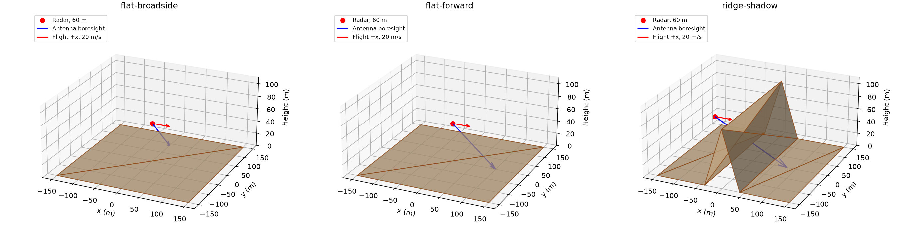
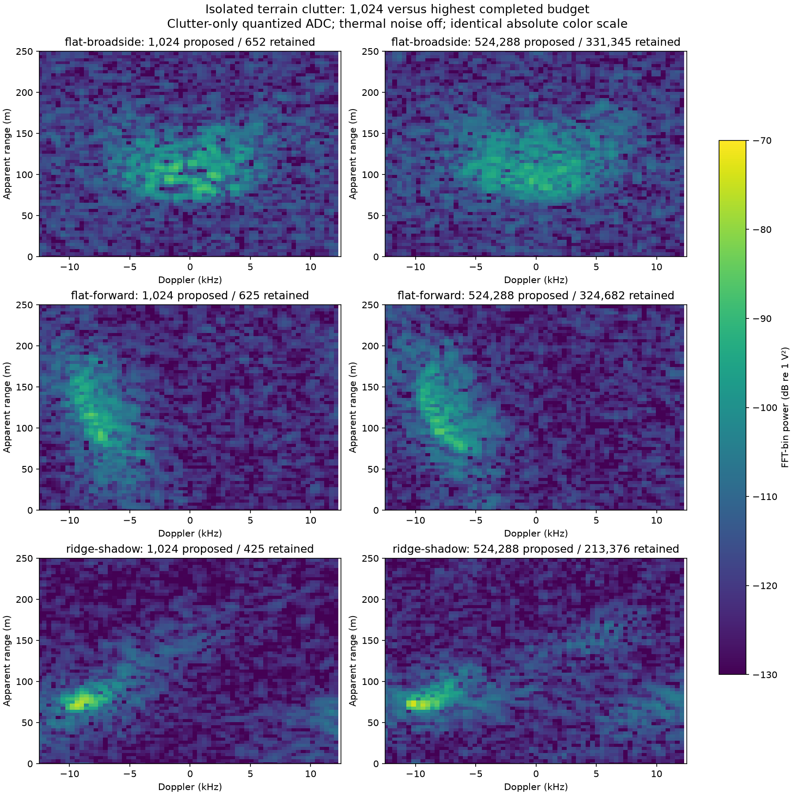
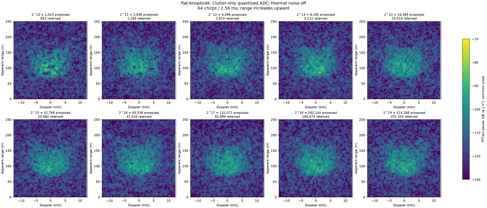
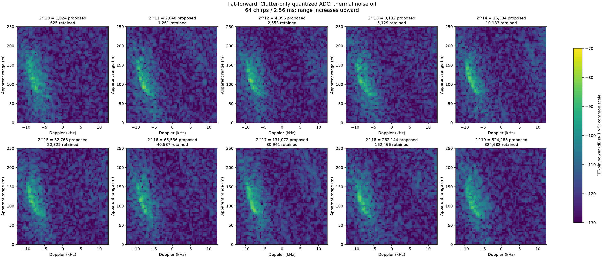
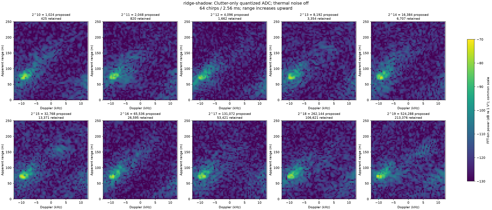
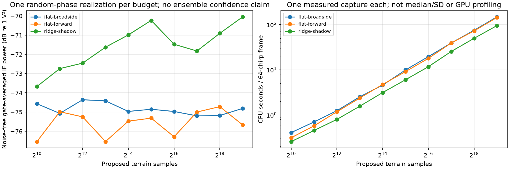

# Clutter-only geometry and sampling audit

This experiment separates **how terrain clutter is generated** from **whether a
noisy receiver can see it**. It uses the production first-order echo source,
actual rendered complex I/Q and the independent radar skill's FFT. No image is
painted from geometric truth or histogrammed paths.

The sweep is **2^10 through 2^19**, inclusive: 1,024, 2,048, 4,096, 8,192,
16,384, 32,768, 65,536, 131,072, 262,144 and 524,288 proposed terrain samples.
These are all the powers of two within 10^3–10^6. The next power, 1,048,576,
exceeds the requested upper bound and is not included. Powers of two are a
controlled budget sequence here; this is CPU execution, not a GPU speed claim.

## Three isolated geometries



| Geometry | Terrain and radar setup | Expected feature |
| --- | --- | --- |
| Flat, side-looking (`flat-broadside`) | 300 × 300 m level patch; radar (0,0,60) m, +x velocity 20 m/s; boresight toward (0,90,0) m | Broadside ground clutter spans both Doppler signs around zero; curved minimum-range boundary |
| Flat, forward-looking (`flat-forward`) | Same patch/radar/velocity; boresight toward (100,0,0) m | Ground ahead is approaching, so the principal clutter lobe shifts to negative Doppler |
| Ridge and RF shadow (`ridge-shadow`) | Same footprint; 90 m ridge at x=0, slopes spanning x=−40..+40 m; radar (−90,0,60) m, +x velocity 20 m/s; boresight toward (80,0,0) m | Front slope plus visible near-ground returns; the actual mesh blocks ground behind the ridge |

Each mesh uses the same explicit earth rule: **sigma0 −20 dB**, cosine incidence
exponent 1 and seed 314159. Flat surface area is 90,000 m²; the ridge's inclined
faces increase its actual surface area. Backscatter is empirical RCS per actual
surface area, not computed from dielectric permittivity. Relative permittivity 5
and conductivity 0.01 S/m identify the shared scene material. No secondary
bounces, target-leg multipath, diffraction or vegetation volume scattering are
added. The monostatic terrain echo is `TX → patch → RX` with direct mesh
visibility. There are no point targets in these tests.

The radar uses the maintained IWR1843-inspired profile: 77 GHz, 12 dBm TX,
7 dBi peak antenna gain at each end, the existing Gaussian 56° × 28° antenna,
50 MHz bandwidth / 32 µs chirp, 40 µs PRI, 10 MS/s and 256 gated ADC samples.
Each map covers **64 pulses / 2.56 ms**, with constant-velocity radar position
recomputed on every chirp. This is not a single-pulse or path-power-only map.
The 12-bit, 1 V-span ADC and 60 dB IF gain remain enabled. Receiver thermal
noise is deliberately disabled for isolation; the **250 m slant-range cap** is
an explicit isolated-fixture setting, rather than the maintained mission's
400 m cap. Full physical/geometry/software settings and source hashes are in
[summary.json](summary.json).

## Clutter-only range–Doppler maps

**Doppler is horizontal; range is vertical, with zero at the bottom.** All maps
use one common absolute FFT-bin power scale, in dB relative to 1 V² of IF signal,
with a 60 dB display span. A coherent-window normalization makes the displayed
power equal to voltage amplitude squared for a bin-centered complex tone.
This is IF voltage power after receiver gain, not RF input dBm or calibrated SNR.
No per-map normalization or ground-strength adjustment hides power differences.
The display spans ±12.5 kHz; 20 m/s at 77 GHz gives a maximum ground Doppler
magnitude of about 10.27 kHz, so these returns are not Doppler-aliased.

The primary figures use **actual quantized ADC I/Q, with receiver thermal noise
off**. Residual ADC quantization artifacts are retained. The separately labeled
pre-ADC figures show the underlying physical clutter waveform before that
quantization. Both use identical axes, color limits and FFT processing.
The ADC step is about **0.244 mV**, comparable to the isolated clutter's
0.15–0.32 mV complex gate RMS. Quantization therefore produces visible out-of-band
artifacts in these thermal-noise-free ADC maps. The pre-ADC reference is essential
for distinguishing the terrain support from this receiver effect. Neither figure
silently raises IF gain or surface RCS to suppress that limitation.



### Side-looking flat terrain: all ten budgets



[Noise-free pre-ADC reference](flat-broadside-pre-adc.png).

### Forward-looking flat terrain: all ten budgets



[Noise-free pre-ADC reference](flat-forward-pre-adc.png).

### Ridge and shadow: all ten budgets



[Noise-free pre-ADC reference](ridge-shadow-pre-adc.png).

The [saved-data verification](validation.json) checks all 30 I/Q pairs, physical
axes, zero clipping, area/RCS normalization and agreement with an independently
computed FFT throughout the displayed power span, plus a 20 dB margin.
The [direct visibility verification](visibility-verification.json) confirms that,
at the largest ridge budget, **120,408 eligible far-ground patches behind the
ridge contribute zero direct echoes**. This is actual mesh blockage, not a mask
applied to a plotted image. The matching flat fixtures have zero mesh-blocked
eligible patches. The ridge changes both terrain and viewing setup; the three
maps are distinct fixtures, not a single-variable ridge-height experiment.

## What changing the count means

`propagation.samples_per_link` is the proposal budget over the complete surface,
not a promise that all points survive antenna, incidence, range and occlusion
checks. One surviving patch generates one first-order terrain echo. The table
counts echoes retained on the **first chirp**; min/max over all 64 chirps are
saved in the summary. Visibility is recomputed every chirp.

| Proposed samples | Flat, side-looking: retained | Flat, forward-looking: retained | Ridge/shadow: retained |
| --- | ---: | ---: | ---: |
| 2^10 = 1,024 | 652 | 625 | 425 |
| 2^11 = 2,048 | 1,284 | 1,261 | 820 |
| 2^12 = 4,096 | 2,614 | 2,553 | 1,662 |
| 2^13 = 8,192 | 5,212 | 5,129 | 3,354 |
| 2^14 = 16,384 | 10,419 | 10,183 | 6,707 |
| 2^15 = 32,768 | 20,682 | 20,322 | 13,371 |
| 2^16 = 65,536 | 41,418 | 40,587 | 26,595 |
| 2^17 = 131,072 | 82,894 | 80,941 | 53,421 |
| 2^18 = 262,144 | 166,074 | 162,466 | 106,621 |
| 2^19 = 524,288 | 331,345 | 324,682 | 213,376 |

Each proposal represents `actual total surface area / proposal count`. Its RCS
shrinks proportionally when the budget grows, and its voltage scales with the
square root of that RCS. Thus expected scattered power stays fixed. Increasing
the count should fill undersampled range/Doppler support and change the speckle,
rather than make the same surface hundreds of times stronger.

The sampler changes its positions and fixed random scattering phases when the
budget changes. This sweep uses **one realization per budget**, not nested
coherent samples or an ensemble confidence interval. Individual bright pixels
are not expected to converge monotonically. Even a dense, resolved coherent
clutter map retains speckle. The figures establish the behavior of these fixtures;
they do not establish that 1,024 samples suffice for every terrain or waveform.

The following RMS voltage is averaged over actual ADC gate times, excluding
zero-filled PRI gaps, **before ADC quantization and with thermal noise off**:

| Proposed samples | Flat, side-looking (mV RMS) | Flat, forward-looking (mV RMS) | Ridge/shadow (mV RMS) |
| --- | ---: | ---: | ---: |
| 1,024 | 0.1869 | 0.1490 | 0.2072 |
| 2,048 | 0.1764 | 0.1781 | 0.2306 |
| 4,096 | 0.1914 | 0.1727 | 0.2383 |
| 8,192 | 0.1901 | 0.1490 | 0.2622 |
| 16,384 | 0.1785 | 0.1684 | 0.2822 |
| 32,768 | 0.1808 | 0.1714 | 0.3078 |
| 65,536 | 0.1784 | 0.1533 | 0.2669 |
| 131,072 | 0.1738 | 0.1778 | 0.2563 |
| 262,144 | 0.1741 | 0.1837 | 0.2849 |
| 524,288 | 0.1817 | 0.1646 | 0.3144 |



## Measured CPU cost for these maps

These are **one capture per configuration**, including 64 per-chirp visibility
checks, coherent IF synthesis and ADC conversion; no median/SD or GPU estimate
is implied. The separate initial scatterer preparation and two FFT calls are
recorded in the machine-readable summary. No AirSim physics/RPC/camera, network,
recording service or full dashboard is included. Short local verification work
also ran on the shared CPU during parts of the sweep; do not treat these as
controlled throughput measurements or compare them directly with end-to-end
mission latency. The maintained [runtime report](../first-order-radar-20261023/REPORT.md)
remains the source for the earlier repeated CPU benchmark and its exclusions.

| Proposed samples | Flat, side-looking: seconds / 64 chirps | Flat, forward-looking: seconds / 64 chirps | Ridge/shadow: seconds / 64 chirps |
| --- | ---: | ---: | ---: |
| 1,024 | 0.409 | 0.314 | 0.258 |
| 2,048 | 0.702 | 0.575 | 0.455 |
| 4,096 | 1.247 | 1.182 | 0.799 |
| 8,192 | 2.525 | 2.373 | 1.563 |
| 16,384 | 4.585 | 4.735 | 3.131 |
| 32,768 | 9.909 | 9.096 | 6.016 |
| 65,536 | 19.526 | 17.870 | 11.680 |
| 131,072 | 39.099 | 39.086 | 25.406 |
| 262,144 | 74.708 | 72.354 | 49.556 |
| 524,288 | 147.882 | 143.047 | 94.783 |

CPU: `AMD EPYC 9V74 80-Core Processor`; cgroup quota `200000 100000`;
Dr.Jit tracing thread count 2. NumPy renders the IF on the host; Mitsuba uses
`llvm_ad_mono_polarized`. There is **no measured GPU result** in this sweep.
The term count remains linear in retained echoes × 256 samples × 64 chirps;
there is no outbound/inbound path cross-product.

## Why the maintained dashboard can still look noise-like

The isolated maps omit receiver thermal noise and use a low-altitude, smaller
fixture. They are not a claim that the maintained mission's clutter is visible
above its receiver noise. The earlier matched-noise audit kept the actual
mission's antenna, sigma0, power, ADC and 1,024-point budget unchanged:

| Maintained mission viewpoint | Terrain echoes, first chirp | Strongest isolated pre-ADC clutter FFT bin / median actual noise-only ADC FFT bin |
| --- | ---: | ---: |
| Start | 364 | −10.3 dB |
| East | 355 | −7.3 dB |
| Terrain-masked | 296 | approximately 0 dB |

See the [matched-noise audit data](../radar-clutter-display-20261023/summary.json)
and [paired full-scene, clutter+noise, noise-only and pre-ADC reference maps](../radar-clutter-display-20261023/east.svg).
Before nonlinear ADC quantization, `(clutter + noise) − noise` reproduces the
isolated clutter waveform to about 2 nanovolts in these captures. Clipping is
zero. Clutter is generated and reaches I/Q; that result does not establish that
our uncalibrated −20 dB sigma0 and receiver assumptions match a real field site.

No slow-time zero-Doppler clutter notch is applied. Per-ramp mean removal
suppresses fast-time DC, not all stationary-terrain echoes. The previous −20 dB
floor in returned display contrast values is removed, and the dashboard offers
color presets; neither display correction can recover signal physically buried
under receiver noise. Known old recordings get a presentation-only axis
projection; previously clipped archived values cannot be reconstructed.

## Published comparisons and limits

- MathWorks, [Introduction to Radar Scenario Clutter Simulation](https://www.mathworks.com/help/radar/ug/introduction-to-radar-scenario-clutter-simulation.html):
  surface-clutter I/Q, terrain shadowing, spatial/adaptive sampling and a
  Doppler-horizontal/range-up map with a 60 dB plotting span.
- MathWorks, [Predict Surface Clutter Power in Range-Doppler Space](https://www.mathworks.com/help/radar/ug/predict-surface-clutter-power-in-range-doppler-space.html):
  range/Doppler support changes with motion and antenna squint. Static terrain
  can have substantial nonzero Doppler when the radar moves. A noise-free power
  prediction is not equivalent to a noisy ADC measurement.
- MathWorks, [Bistatic Clutter Part 3: Simulating Site-Specific Bistatic Land Clutter](https://www.mathworks.com/help/radar/ug/bistatic-clutter-part-3-simulating-site-specific-bistatic-land-clutter.html):
  patch RCS/area, random-phase clutter and explicit comparison of noise-free
  clutter maps with I/Q where weak returns disappear below noise.

Our first-order empirical backscatter and Gaussian antenna reproduce these
basic geometry-dependent effects. These comparisons do not validate the
77 GHz sigma0, terrain calibration, land-cover statistics, polarization, multiple
scattering or real hardware performance. No vendor figure is reused.

## Reproduce or reprocess the saved I/Q

From an environment with this repository's RF dependencies and the pinned
independent Radar-skill installed:

```bash
python benchmarks/sweep_clutter_sampling.py --output /work/clutter-sweep
# Validate the complete saved sweep and the terrain shadow:
python benchmarks/verify_clutter_sweep.py --input /work/clutter-sweep
# Rebuild every plot from already saved data, without rerendering I/Q:
python benchmarks/sweep_clutter_sampling.py --output /work/clutter-sweep --figures-only
```

Completed cases are checkpointed and resumable; changed model/source hashes are
rejected rather than mixed. Each `GEOMETRY-2pEXPONENT.npz` stores
`analog_iq_volts`, `adc_iq_volts`, `analog_dbv2`, `adc_dbv2`, `range_m` and
`doppler_khz`. The complex arrays contain 64 × 400 continuous sample slots,
including the recorded 256-sample receive gates and zero-filled PRI gaps.
These small analysis artifacts are NumPy archives, not a new receiver streaming
contract; mission-scale GNU Radio/SigMF exports remain unchanged.
The skill receives only I/Q and acquisition metadata, never the mesh, sample
positions, scattering phases or the expected map shape.

To export one quantized receiver stream as GNU Radio-compatible complex float32
volts without rerunning the source:

```python
import numpy as np
with np.load("flat-broadside-2p19.npz") as saved:
    saved["adc_iq_volts"].astype("<c8").tofile("clutter.cf32")
```

Use a complex File Source at 10 MS/s; the PRI gate gaps are part of the stream.
Acquisition metadata is in summary.json. The reference `analog_iq_volts` is a
separate pre-ADC diagnostic and must not be relabeled as digitized hardware data.
