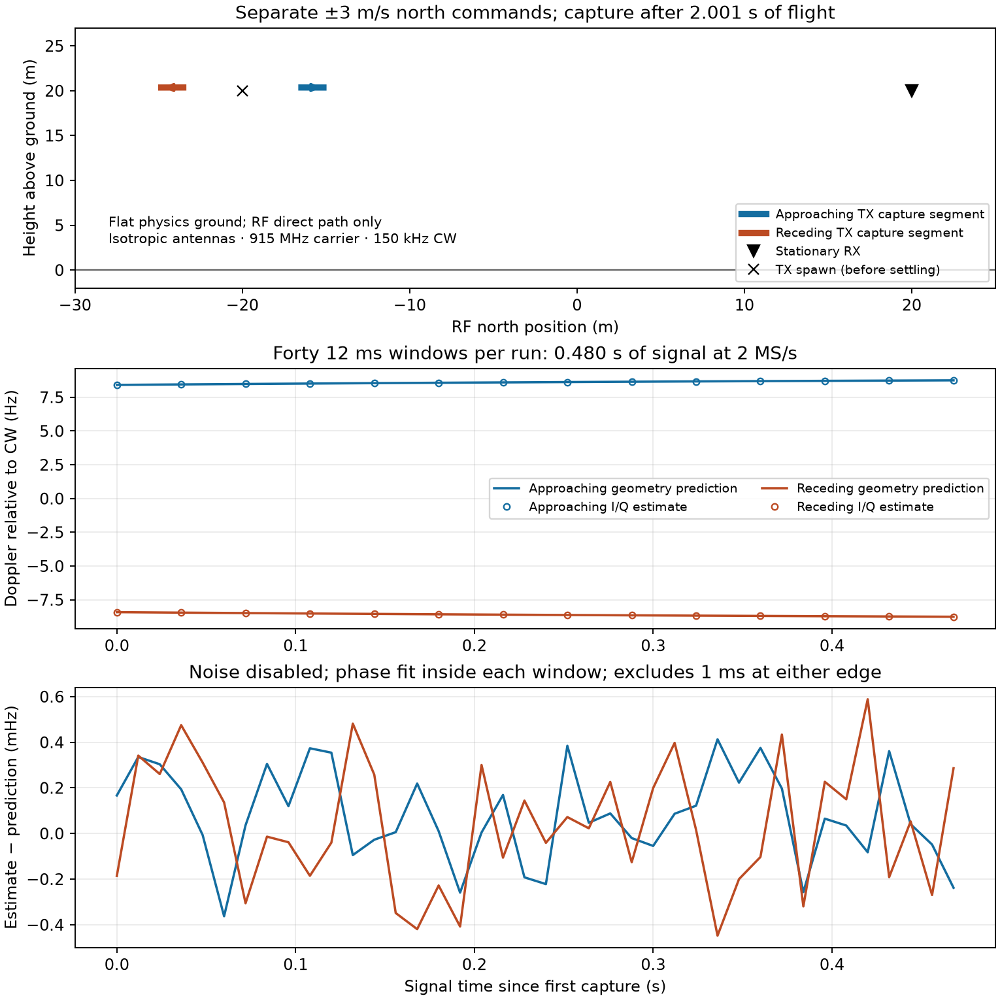

# Live moving-flight qualification — 2026-10-11

**Passed for a controlled direct-path case.** The real ProjectAirSim Runtime
flight controller moved a Fast Physics transmitter toward and away from a fixed
receiver. The SDR output has contiguous samples and the expected signed Doppler.
This extends the [stationary smoke test](../project-quality-20261009/live-server/REPORT.md).



## Scenario and measurement

Two separate scenes start with TX at RF north −20 m, height 20 m, and RX at
north +20 m, height 20 m. RF axes are north/west/up; the simulator uses NED.
The TX uses the pinned upstream quadrotor with Simple Flight and Fast Physics;
cameras are removed because Runtime does not render them. RX is a stationary
non-physics robot. Commands request +3 and −3 m/s north, with zero east/down
velocity. After 2.001 simulated seconds of settling, actual north speed is about
2.76–2.87 m/s during capture. Predictions use measured server velocity, not the
commanded 3 m/s. Height remains near 20.36 m.

Propagation and signal rendering run on the P100 (`cuda_ad_mono_polarized`,
`basis-cuda`). Vehicle physics runs in the Runtime server. The RF scene uses only
the direct path (`max_depth=0`): flat ground exists for physics, but its reflected
RF path is deliberately excluded to isolate the velocity-to-Doppler contract.
Antennas are isotropic with vertical polarization. The source is a 10 mW,
+150 kHz complex CW at a 915 MHz carrier, sampled at 2 MS/s. Noise is disabled;
the normal receiver filter and signed 12-bit ADC remain active. No ADC clipping
occurred. This is a numerical integration check, not a claim of measured radio
accuracy or realistic sensing performance in noise.

For each paused start snapshot, the prediction is
`f_D = (f_c/c) × dot(v_TX − v_RX, unit(RX − TX))`.
Each 12 ms capture freezes that starting geometry and evolves narrowband Doppler.
The estimator removes the known 150 kHz tone and fits unwrapped phase over the
central 10 ms, excluding 1 ms at each edge. A known single-tone phase fit can
estimate frequency below FFT bin spacing; this does not establish the ability
to resolve two nearby signals. The plot shows every third measured frequency
marker for readability and all 40 error values.

## Results and timing scope

Each run records **40 × 12 ms = 0.480 signal seconds**, comprising **960,000
complex samples** (3,840,000 data bytes) at the one receiver. Displacement is
between the first and last start snapshots, which are 0.468 s apart.

| Measurement | Approaching | Receding |
|---|---:|---:|
| TX displacement over snapshots | 1.31934 m | 1.31932 m |
| Predicted Doppler, first → last | +8.415 → +8.754 Hz | −8.415 → −8.754 Hz |
| Maximum absolute Doppler estimation error | 0.000413 Hz | 0.000589 Hz |
| Recorded signal duration | 0.480 s | 0.480 s |
| Capture service wall duration | 7.081 s | 7.399 s |
| Wall seconds per signal second | 14.753 | 15.415 |

The fixed acceptance threshold was 0.5 Hz, together with more than 0.5 m of
motion, the commanded Doppler sign, zero clipping, and successful completion of
the flight command. Both cases pass all checks. These small noiseless residuals
are not measurement uncertainty estimates.

The service timer includes paused snapshot/RPC logging, physics advancement for
the recorded windows, RF processing, file writes and per-window metadata
checkpoints, including first-use compilation. It excludes container startup,
scene loading, the 2.001 s settling interval, final checkpoint, post-capture
flight-command completion, analysis, and disconnect. Total flight-command
simulation spans 5.100 s; only the middle 0.480 s has SDR output. Writes are not
fsync-ed. Existing host services remained running; the receding run overlapped
the CPU regression suite. **These are correctness runs, not isolated performance
benchmarks**, and their wall ratios must not be used to compare optimizations.

## Evidence and reproduction

[Approach results](approach/motion.json) and [recede results](recede/motion.json)
contain all per-window predictions and estimates. Each directory also includes
actual ground-truth kinematics, generated robot/scene configurations, recording
manifest, SigMF metadata, structural inspection and client log. Manifests include
source/configuration hashes and the Runtime commit
`cfb865f29f255b15ef28ec8fdcfaa01a6b66497f`.
The [server log](server.log) includes exploratory and final runs. Raw I/Q stays
in ignored `recordings/`; published inspections include SHA-256 hashes.

Start the Runtime as described in the [live guide](../../../docs/reference/live-workflow.md).
Run each command separately against that server (each loads a fresh scene):

```bash
docker run --rm --gpus device=0 --network host --tmpfs /.drjit:rw,mode=1777 \
  --user "$(id -u):$(id -g)" -v "$PWD:/work/repo" -w /work/repo \
  -e PYTHONPATH=/work/repo/src \
  --entrypoint /opt/airsim-rf/.venv/bin/python airsim-rf:p100-modern-gpu \
  scripts/basis_launch.py scripts/qualify_live_motion.py --pascal-compat \
  --velocity 3 --output recordings/live-motion-approach
```

Repeat with `--velocity -3 --output recordings/live-motion-recede`.
The pinned source checkout at `.deps/ProjectAirSim-runtime` is required; the
Runtime build script creates it. Output directories must be new.
Regenerate the figure in a scientific Python environment:

```bash
python scripts/plot_live_motion.py \
  results/reviews/live-motion-20261011/approach \
  results/reviews/live-motion-20261011/recede \
  --output results/reviews/live-motion-20261011/motion.png
```

The [standard regression log](standard-tests.log) records **190 passed, 157
skipped**. GPU-dependent cases skipped by that suite are not counted as passes;
the two real moving experiments exercise GPU propagation and rendering directly.
The documented configuration-only CLI was also fixed and regression-tested.

## Remaining qualification

Subsequent evidence: [phase-boundary, cadence and specular-path checks](../live-phase-20261011/REPORT.md). The paragraphs below describe the gaps at the time of this initial run.

Sample/time continuity passes; **carrier phase continuity across refreshed
channel windows is not yet qualified**. The phase fit intentionally excludes
window edges. Next test the phase residual at those boundaries and its sensitivity
to physics/RF update cadence, then add reflected/diffuse paths and moving RXs.
Unreal mesh alignment, rendered sensors, terrain collision, RF hardware calibration
and real-time wall-clock streaming remain outside this result. No propagation or
rendering optimization was introduced for this particular scenario.
