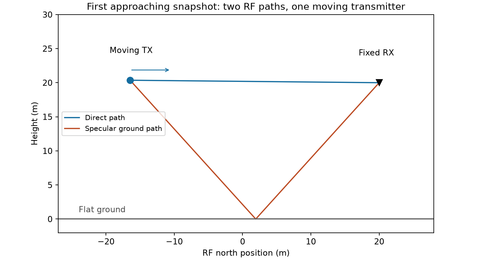
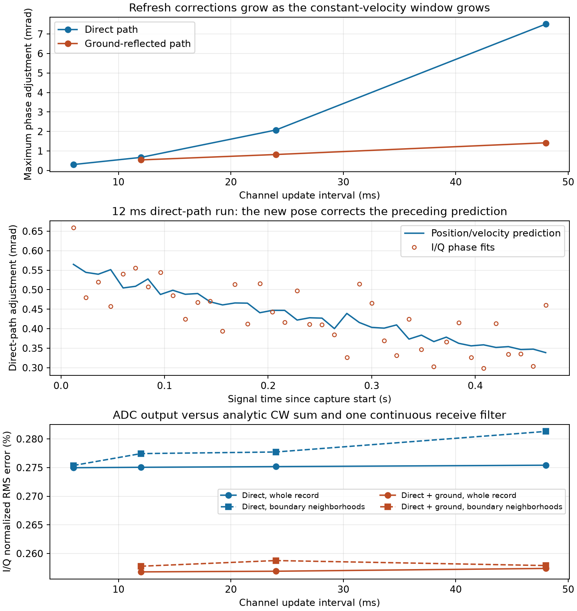

# Moving-channel phase and ground-reflection qualification — 2026-10-11

**All eight real Runtime cases passed the stated model-consistency checks.**
There is no evidence of an unintended renderer or receiver-filter reset at
channel boundaries. There are small, nonzero phase corrections when a new pose
replaces the previous window's constant-velocity prediction. Longer windows
increase those corrections. This qualifies a bounded piecewise-channel model;
it does not make the output an exactly continuous solution of accelerating motion.

## Physical scenario



The [previous moving-flight experiment](../live-motion-20261011/REPORT.md)
provides the flight setup. The same real Fast Physics quadrotor starts at north
−20 m and height 20 m; a non-physics RX remains at north +20 m and height 20 m.
After 2.001 simulated seconds under a +3 m/s north command, the TX approaches
at an actual speed of about 2.76–2.87 m/s. One reversed-command run recedes.
Both use the actual measured velocity, not the commanded speed, for predictions.
All runs record **0.480 signal seconds per receiver**, or **960,000 complex
samples at 2 MS/s**. Requested windows are exact multiples of the 3 ms physics
tick. Changing the interval changes the number of channel updates, not the
recorded signal duration.

The direct cases contain only LoS. The specular cases contain LoS plus one ground
reflection, using the exhaustive single-bounce solver. The ground is the existing
synthetic dielectric mesh: relative permittivity 5, conductivity 0.01 S/m,
thickness 0.5 m, scattering coefficient 0.3. **Diffuse rays are disabled** for
this controlled check. The 915 MHz carrier, +150 kHz CW, 10 mW source, isotropic
vertically polarized antennas, disabled noise, receiver filter and 12-bit ADC
match the earlier test. Propagation and rendering execute on the P100; the Runtime
server advances vehicle physics. No physical RF hardware is involved.

## What was checked

1. **Geometry independently of the traced paths.** LoS length comes from TX–RX
   separation. Reflected length comes from mirroring RX position/velocity below
   the flat ground. Those constructions predict each path's delay and radial
   Doppler. Every specular snapshot must contain exactly two paths.
2. **Signal rendering independently of the renderer.** A NumPy analytic CW sum
   uses the exported complex path gains, delays and Dopplers, then runs one
   continuous SciPy receive filter over the entire record. The ADC codes are
   converted to volts for comparison. This checks waveform timing, path summation
   and filter continuity, but deliberately shares the solver's complex gains;
   it does **not independently validate Fresnel amplitudes or polarization**.
3. **Boundary neighborhoods.** I/Q normalized RMS error is measured over the
   full record and separately over 128 samples on each side of every update
   (64 microseconds per side). The first startup is included in the full-record
   comparison. The reference includes the same finite-window pose corrections.
4. **Phase corrections.** Per-path gain phase and envelope-delay changes are
   compared with continuation of the previous local Doppler. The geometry-only
   prediction uses the next actual path length. Direct-path ADC phase fits also
   measure this adjustment, excluding 1 ms at each edge to avoid filter transients.
   For the reflected path, a remaining gain-phase contribution can include the
   changing material/polarization response; it is not solely position error.
5. **Negative control.** A private copy of the 12 ms direct recording receives
   a deliberate π phase reset halfway through. The analysis rejects it, with
   about 143% I/Q normalized RMS error and a fitted boundary jump near π.
   The original recording is unchanged. [Negative-control result](direct-12/negative_control.json).

The fixed guards are path-length error below 1 mm, path-Doppler error below
1 mHz, phase residual after the geometric correction below 0.01 rad, and I/Q
normalized RMS error below 1% for both full records and boundary neighborhoods.
The direct ADC/geometry phase residual also must stay below 0.01 rad. These are
experiment acceptance limits, not uncertainty estimates or universal fidelity
requirements. A pass does not require the finite-window phase correction to vanish.

## Results



The figure shows approaching runs. The reversed-motion specular check is included
in the table and its own JSON. Phase adjustment is the maximum over paths and
updates; the separate orange curve in the top panel isolates the reflected path.
I/Q errors include ADC quantization and numerical waveform approximation.

| Case | Updates | Maximum phase adjustment (rad) | I/Q error, whole / boundary (%) | Service wall (s) / signal (s) | Wall s / signal s |
|---|---:|---:|---:|---:|---:|
| [direct-6](direct-6/phase.json) | 80 | 0.000305 | 0.275 / 0.275 | 8.078 / 0.480 | 16.829 |
| [direct-12](direct-12/phase.json) | 40 | 0.000671 | 0.275 / 0.277 | 7.505 / 0.480 | 15.635 |
| [direct-24](direct-24/phase.json) | 20 | 0.002075 | 0.275 / 0.278 | 6.685 / 0.480 | 13.927 |
| [direct-48](direct-48/phase.json) | 10 | 0.007507 | 0.275 / 0.281 | 6.505 / 0.480 | 13.553 |
| [specular-12](specular-12/phase.json) | 40 | 0.000671 | 0.257 / 0.258 | 7.477 / 0.480 | 15.578 |
| [specular-24](specular-24/phase.json) | 20 | 0.002075 | 0.257 / 0.259 | 6.926 / 0.480 | 14.429 |
| [specular-48](specular-48/phase.json) | 10 | 0.007507 | 0.257 / 0.258 | 6.915 / 0.480 | 14.407 |
| [specular-recede-12](specular-recede-12/phase.json) | 40 | 0.000629 | 0.331 / 0.334 | 8.470 / 0.480 | 17.647 |

Across all cases, geometric path-length disagreement is below 6.4 micrometers
and path-Doppler disagreement below 0.000013 Hz. These are numerical agreement
figures within the same simulated coordinate system, not physical calibration
accuracy. The direct ADC phase-adjustment prediction differs by less than
0.000158 rad. The injected reset proves that small residuals are not obtained by
silently discarding an arbitrary phase offset at every window.

The direct-path phase adjustment grows from about **0.000305 rad at 6 ms** to
**0.007507 rad at 48 ms** (about 0.43°). It follows the expected correction from
new geometry rather than a random renderer phase reset. The model holds source
delay and gain fixed inside a window and evolves only narrowband Doppler; changing
velocity, propagation direction, and refreshed envelope delay prevent exact
phase continuity under general motion. Shorter windows reduce this approximation,
but these results do not select a universal update cadence.

## Timing scope

Each table entry uses **0.480 s of represented signal**, at one receiver. Service
wall time includes snapshot/RPC logging, recorded physics steps, tracing,
additional channel export for this audit, signal generation, data writes, and
per-window checkpoints, including first-use compilation. It excludes startup,
scene loading, settling, final checkpoint, remaining command completion to
5.100 simulated seconds, analysis, plotting and disconnect. Writes are not
fsync-ed. Existing host services remained running, and some runs overlapped CPU
regression tests. These are correctness results, **not isolated performance
benchmarks or a cadence speedup claim**.

## Reproduce and inspect

Start the pinned Runtime using the [live guide](../../../docs/live-workflow.md).
Use the container command from the preceding moving-flight report, adding
`--window-ms 6`, `12`, `24` or `48` and a new output directory for each run.
Add `--reflection` for the two-path cases; add `--velocity -3` for recession.
The approaching specular sweep uses 12, 24 and 48 ms. Do not run simultaneous
scene-loading experiments against the same Runtime server.

Analyze each fresh recording in the scientific Python environment:

```bash
python scripts/analyze_live_phase.py recordings/your-run
python scripts/analyze_live_phase.py recordings/your-direct-12-run --negative-control
python scripts/plot_live_phase.py results/reviews/live-phase-20261011
```

Every published case includes its phase checks, exported channels, actual
trajectory, recording manifest, structural inspection, metadata and client log.
[Shared simulator configurations](sim_config/scene.jsonc) are identical across
cases and their hashes are in each manifest. The [server log](server.log) records
all cases. Raw I/Q remains in ignored `recordings/`; inspections preserve its
SHA-256 hash. Full signal reanalysis requires rerunning the capture or retaining
that raw data; the figures regenerate from the committed JSON alone.

The [regression log](standard-tests.log) records **192 passed, 157 skipped**.
Tests include a known phase reset and an analytic 3–4–5 reflected-path geometry.
GPU-dependent tests skipped by the standard suite are not counted as passes;
the eight real experiments exercise GPU tracing/rendering directly.

## What changes and what remains

No propagation/rendering fix or scenario-specific optimization was warranted by
these checks. The work adds reproducible qualification, negative controls and
clearer fidelity limits. Default production rendering behavior is unchanged.
The next useful extensions are moving receivers, acceleration/turns, and diffuse
or obstructed paths with path births/deaths. A demanding coherent application
should specify its phase-error budget before choosing an update interval or
requiring interpolation between channel solutions. Unreal mesh alignment,
terrain collisions, physical RF calibration and real-time wall-clock streaming
remain outside this result.
