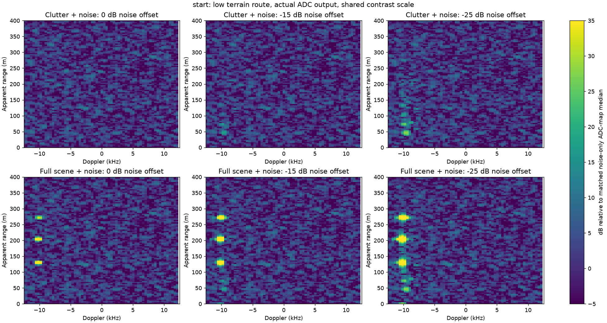
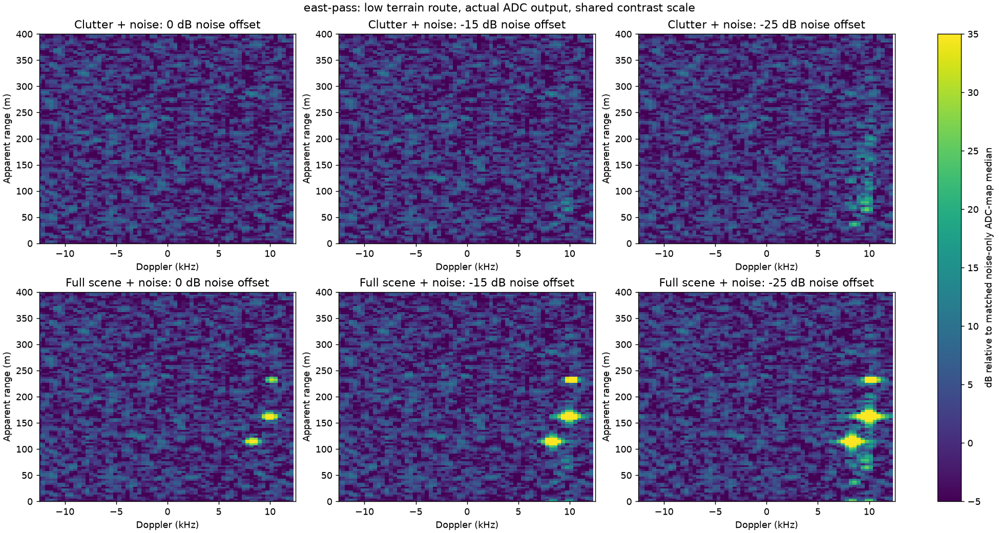
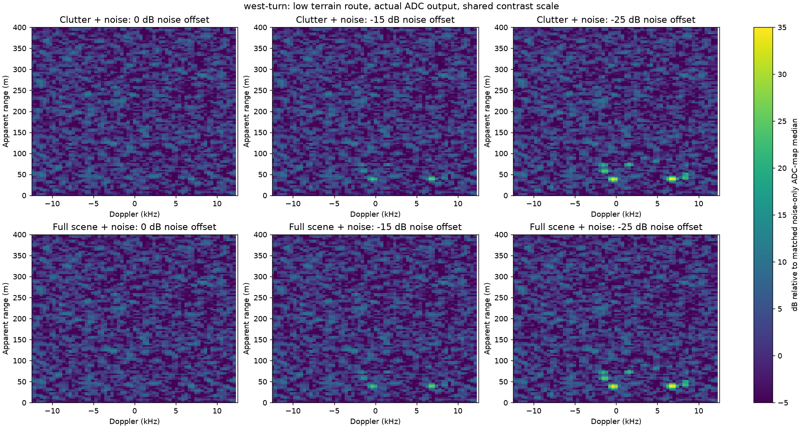
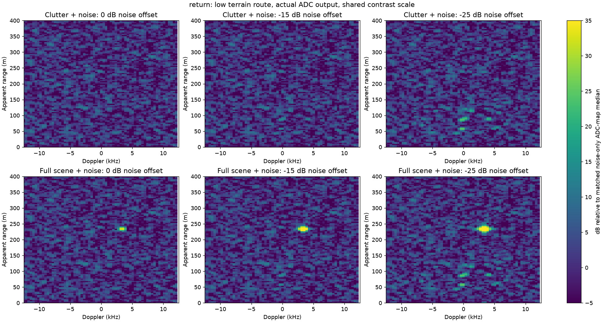

# Main demo: low terrain flight and tunable receiver noise

The packaged direction-finding and radar demos now select **20 m minimum planned
terrain clearance**, a **0.2 maximum ascent/descent grade** and a nominal absolute
height floor of 120 m RF-up. The circle/racetrack horizontal routes and speeds
are preserved. The compiler adds terrain triangle-boundary waypoints and plans
altitude ahead of hills. Native ProjectAirSim remains the flight controller;
actual readback drives RF. Some sections stay higher to limit climb/descent.

[Exact edit locations and knob semantics](../../../docs/demo-tuning.md).

## Planned route checks

The route test checks terrain clearance between authored waypoints, climb grade,
periodic closure, and agreement between native spawn/settling and compiled flight.
The table samples the planned 3-D routes at 1 m intervals; it does not claim
native flight tracking measurements. See [route-check.json](route-check.json).

| Scenario | Minimum AGL (m) | Median AGL (m) | Maximum AGL (m) | Median RF-up altitude (m) |
| --- | ---: | ---: | ---: | ---: |
| drone-orbit | 20.0 | 21.3 | 65.2 | 164.9 |
| mmwave-radar | 20.0 | 20.3 | 57.1 | 161.7 |

The old constant heights were 200 m for the DF orbit and 210 m for radar.
The shared DEM and its RF/Unreal geometry are unchanged. Low flight is a planned
native path, not an artificial position clamp applied to the channel solver.

## Radar ADC comparison

The selected demo default is **−25 dB thermal-noise power offset**, about 1/316
of the baseline modeled noise power. **0 dB restores the original receiver
noise model**. This is explicitly a visualization adjustment, not a claim about
measured IWR1843 hardware performance. Noise figure, temperature, TX/IF gains,
antenna, sigma0, exaggerated target RCS and ADC transfer are unchanged.
The model still uses the configured 1,024 terrain proposals and 400 m range cap.

Four planned-route snapshots are rendered with 0, −15 and −25 dB noise offsets.
Each uses actual ADC I/Q from the production first-order source, including
thermal noise and quantization, followed by the independent radar skill FFT.
Each capture is 100 chirps / 4 ms; the FFT uses the first 64 chirps / 2.56 ms.
In each figure the top row isolates clutter+noise and the bottom row includes
all targets+clutter+noise. The beam tracks the same first target in both rows;
removing targets for the diagnostic does not repoint the antenna.

The common color scale is −5 to +35 dB relative to the **matched noise-only ADC
map median** for that column. It is not RF input power, calibrated SNR or CFAR.
The dashboard uses its existing current-map-median contrast convention; it does
not have access to this evaluation's noise-only reference. The low-noise column
shows ground returns in the full-scene map, alongside the much stronger target
returns. All checked full-scene ADC captures have zero clipping.

| Viewpoint | Peak clutter+noise / noise median, offset 0 (dB) | Offset −15 (dB) | Offset −25 (dB) | Terrain echoes, first chirp |
| --- | ---: | ---: | ---: | ---: |
| start | 13.0 | 18.0 | 28.1 | 263 |
| east-pass | 13.1 | 16.4 | 26.3 | 285 |
| west-turn | 13.1 | 24.8 | 34.5 | 187 |
| return | 13.1 | 14.5 | 25.0 | 258 |

A peak in a noisy map can be a noise fluctuation; the approximately 13 dB peaks
in the baseline column are not measurements of isolated clutter SNR. The paired
maps demonstrate the selected visibility setting. One seed and four snapshots
do not establish detectability over an entire mission or hardware calibration.









## Direction-finding source check

At four orbit positions the production one-way source renders eight finite,
quantized receiver streams, each with 8,192 samples and the −25 dB demo noise
offset. All captures have zero ADC clipping. Reflections are present on different
sites around the orbit; terrain-masked channels can have no retained paths.
There is no fallback direct ray through the mountain. The report preserves
per-element direct/reflected counts and actual injected thermal noise power.

This check uses the CPU NumPy renderer as an observer audit; it is not profiling
of the deployed CUDA basis renderer, a MUSIC accuracy study or a native flight
run. Direction finding uses one-way **multipath**; the radar maps show monostatic
terrain **backscatter/clutter**. Neither receiver skill receives the terrain or
noise-control definitions. Detector/estimator settings are unchanged.

## Reproduce

[summary.json](summary.json) stores input fingerprints, source-code hashes,
software versions, poses/velocities, noise settings and acquisition results.
In the RF test image, or an environment with the same dependencies:

```bash
python benchmarks/check_demo_clutter.py --output /work/demo-clutter-check
```

The source/camera/consumer container checks remain separate release gates.
This audit makes no end-to-end runtime, native trajectory-tracking or GPU timing
claim. New missions use the new settings; recordings preserve the settings of
the mission that generated their I/Q.
