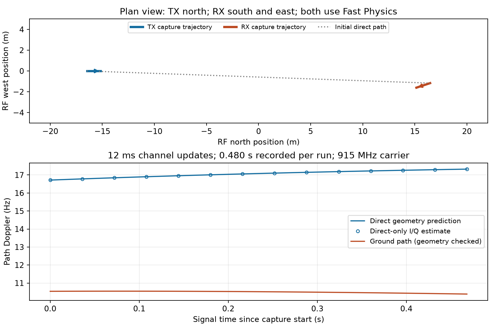

# Two independently moving radios — 2026-10-11

**All three real Runtime cases passed.** This closes the controlled moving-RX
gap for direct and ground-specular propagation, without changing production
rendering. It extends the [phase/cadence qualification](../live-phase-20261011/REPORT.md)
and uses the same independent geometry and analytic-signal checks and thresholds.



Both robots now use the pinned Fast Physics quadrotor and Simple Flight controller.
TX starts at NED (−20, 0, −20) m and receives a (3, 0, 0) m/s velocity command.
RX starts at (20, 0, −20) m and receives (−3, 1, 0) m/s. Both fly for 2.001
simulated seconds before capture. The figure uses RF north/west/up coordinates;
RX's eastward motion therefore has negative west coordinate. Both remain near
20.36 m height over the flat ground. The ground-reflected path has a vertical
component, so its radial closing speed and Doppler are smaller than the direct
path's. The plan-view dotted line is the initial direct path, not an obstruction.

Each run records **0.480 signal seconds**, or **960,000 complex samples at
2 MS/s**. The 12 ms cases use 40 updates; the 48 ms case uses 10. Actual TX/RX
snapshot displacement is 1.319/1.390 m over the 0.468 s span between first and
last starts in the 12 ms runs. At 48 ms, the snapshot span is 0.432 s, explaining
the smaller displacement despite equal recorded duration. Both flight commands
complete successfully and no ADC clipping occurs.

| Case | Whole-record I/Q NRMSE | Boundary I/Q NRMSE | Maximum path phase correction | Service wall / signal | Wall s / signal s |
|---|---:|---:|---:|---:|---:|
| [Direct, 12 ms](direct-12/phase.json) | 0.243% | 0.244% | 0.001083 rad | 7.104 s / 0.480 s | 14.800 |
| [Direct + ground, 12 ms](specular-12/phase.json) | 0.239% | 0.239% | 0.001325 rad | 7.460 s / 0.480 s | 15.543 |
| [Direct + ground, 48 ms](specular-48/phase.json) | 0.240% | 0.236% | 0.014079 rad | 6.906 s / 0.480 s | 14.388 |

Direct-path Doppler rises from about +16.72 to +17.33 Hz during the 12 ms run.
This depends on **both measured velocities**. Path lengths agree with direct/image
geometry within 5.1 micrometers and path Dopplers within 0.0000049 Hz; these are
numerical model agreements, not calibrated accuracy. The analytic I/Q reference
reuses traced complex gains and checks waveform synthesis and continuous filtering;
it does not independently establish Fresnel amplitudes. The 48 ms correction is
larger than in the stationary-RX case, reinforcing that update cadence depends on
relative motion. A consistency pass does not mean phase corrections are zero.

Timing includes capture snapshots/RPC, recorded physics advances, GPU propagation,
audit path export, GPU signal rendering, receiver DSP and data/checkpoint writes,
including first-use compilation. It excludes loading, settling, final checkpoint,
remaining flight-command completion to 5.100 simulated seconds, analysis and
plotting. Host services were left running and the CPU suite overlapped some runs.
These are correctness runs, not an isolated throughput comparison. Propagation
and rendering used the available P100; flight physics used the Runtime server.

## Reproduce

Use the container invocation in the [moving-flight report](../live-motion-20261011/REPORT.md),
adding `--moving-receiver` to `scripts/qualify_live_motion.py`. Run three new output
directories with these additional settings:

- `--window-ms 12`
- `--reflection --window-ms 12`
- `--reflection --window-ms 48`

Analyze each raw recording with `scripts/analyze_live_phase.py` as described in
the phase report. Regenerate this figure from committed JSON with:

```bash
python scripts/plot_moving_receiver.py results/reviews/moving-receiver-20261011
```

Each case includes actual trajectories, path exports, metadata, input hashes,
structural inspection, client log and analysis. [Simulator configuration](sim_config/scene.jsonc)
and [server log](server.log) are shared. Raw I/Q is retained locally in ignored
`recordings/live-phase-20261011-moving-rx-*`; hashes are in the inspections.
The complete standard suite reports **194 passed, 157 skipped** in the
[regression log](standard-tests.log). Two new tests independently differentiate
range under three-dimensional motion at both endpoints, for direct and reflected
paths. GPU-dependent skips are not counted as passes; the real experiments
exercise GPU propagation and rendering. The task Runtime container was stopped.

Remaining live gaps are diffuse paths, occlusion/path births and deaths, explicit
turn maneuvers, and Unreal mesh interoperability. This synthetic flat-ground,
noise-disabled CW test does not qualify all flight scenarios or physical radios.
